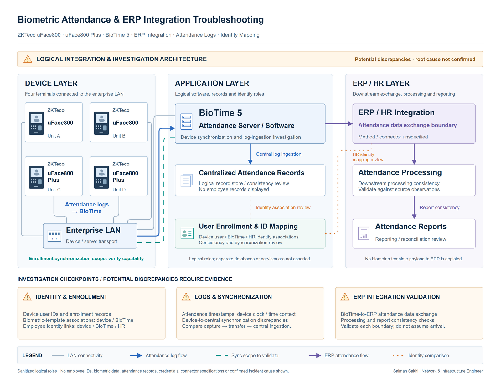

# Biometric Attendance & ERP Integration Troubleshooting

[**View Full Project on My Portfolio**](https://salman-sakhi.web.app/projects/biometric-attendance-erp-troubleshooting)

- **Engineering domain:** IT Systems Integration
- **Classification:** Production Experience
- **Lifecycle / verification scope:** Operational Troubleshooting

## Technical objective

My work covers administration and investigation of biometric attendance infrastructure supporting enterprise HR/ERP workflows. The technical objective is to follow attendance information from device capture through centralized software and downstream processing while checking the consistency of identity relationships. Investigation needs to locate where observations diverge before a cause or remediation can be supported.

## Infrastructure environment

The documented environment includes ZKTeco/uFace attendance devices, BioTime, a logical ERP/HR integration stage, and supporting Windows/database systems. The preserved notes describe four devices, reflected in the logical illustration. The public record does not disclose the integration mechanism, database schema, credentials, employee identifiers, biometric templates, or attendance records. This case study explains functional boundaries rather than the private implementation.

## Technologies and equipment

- ZKTeco
- uFace Devices
- BioTime
- ERP
- Windows / Database Systems

## My documented responsibilities

My administration and diagnostic scope includes attendance devices, centralized software integration, synchronization checks, identity-mapping investigation, log analysis, and device/database inconsistency troubleshooting. The work follows the data path across systems so that a device observation can be compared with centralized and downstream processing. These responsibilities describe the support scope; they do not constitute a completed incident-resolution finding.

## Network or system architecture

*Illustrative systems flow: attendance terminals → BioTime → logical HR/ERP integration, with identity and record consistency reviewed across stages. The diagram contains no real employee information and does not specify the actual transfer or database implementation.*

A record visible at the device is evidence about that stage only. Transfer, centralized ingestion, identity association, and downstream processing each require their own context before the complete workflow can be understood.

## Implementation or troubleshooting approach

The approach distinguishes device connectivity and capture from synchronization and application processing. Authorized observations can then be compared across stages, considering relevant timestamps and processing state. The preserved procedure also identifies device clock behavior and record-update context as investigation points; these checks are methods, not established causes.

Identity comparison needs the appropriate identifiers and system relationships under authorized access. The important question is where the records first differ and what observations support that difference. A mismatch alone does not identify a person, prove misuse, or establish why it occurred. Remediation should follow a supported explanation rather than the first visible inconsistency.

## Operational challenges

Device state, network access, software configuration, identity relationships, and database consistency can affect the same workflow. A downstream symptom may originate at a different boundary, and timestamps can require careful interpretation. Preserving traceability without exposing private attendance information is therefore part of the investigation itself. Public examples should remain procedural and non-identifying.

## Verification evidence

The public evidence establishes administration and diagnostic scope across attendance and ERP workflows. It does not present a completed root-cause analysis or verified incident resolution. Validation compares device capture, transfer, centralized ingestion, and downstream integration separately using authorized records. No employee-level example, real attendance log, biometric record, or database extract is included here. The described comparisons are investigation methods rather than published passed tests.

## Outcome and current scope

This case study records my attendance-system administration and integration-troubleshooting experience. The current public outcome is a bounded diagnostic account of the device-to-ERP path. No specific corrective action, recovery metric, individual attribution, or resolved data-integrity incident is claimed. Findings belong in authorized incident records and require evidence beyond this portfolio overview.

## Related technical skills

Attendance-device administration, centralized-software support, synchronization analysis, identity-mapping comparison, log interpretation, cross-system data tracing, Windows/database dependency awareness, and privacy-conscious incident documentation.

## References

- [Current portfolio case study](https://salman-sakhi.web.app/projects/biometric-attendance-erp-troubleshooting)
- [Preserved detailed project notes](../biometric-attendance-erp-troubleshooting.md)
- [GitHub profile and project index](../../README.md)
