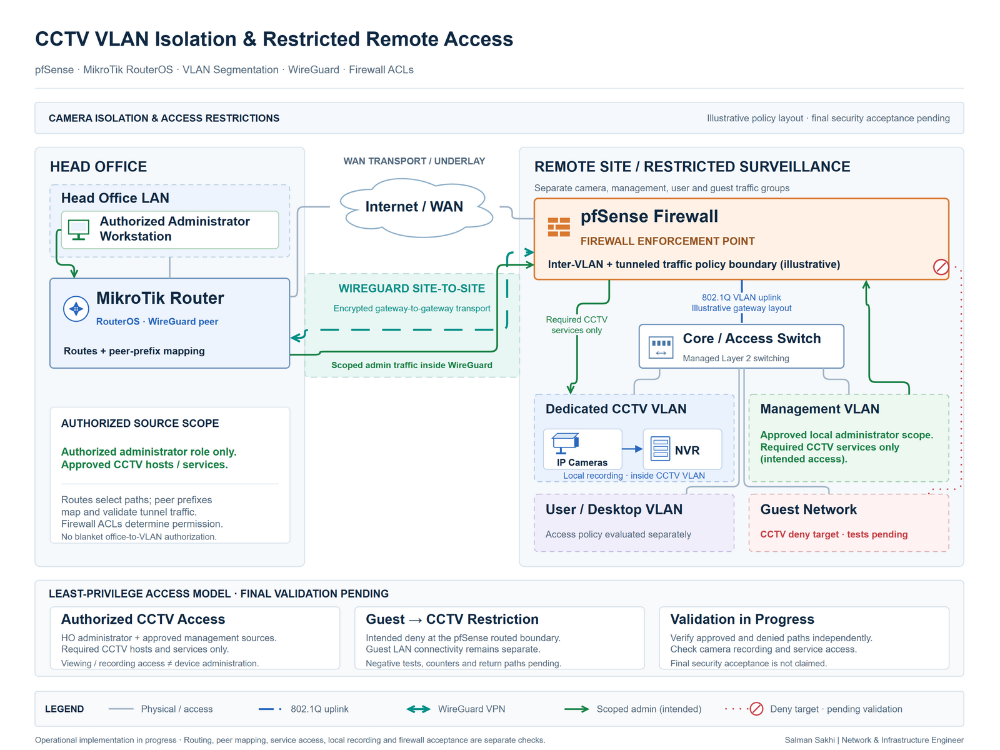

# CCTV VLAN Isolation & Restricted Remote Access

[**View Full Project on My Portfolio**](https://salman-sakhi.web.app/projects/cctv-vlan-isolation-remote-access)

- **Engineering domain:** Network Security
- **Classification:** Network Security Implementation
- **Lifecycle / verification scope:** Operational Implementation / In Progress

## Technical objective

My objective is to separate CCTV devices into a dedicated subnet while preserving controlled access for authorized office and management networks. The work also considers required remote access over a routed WireGuard path. This is an ongoing security implementation, distinct from broader experience supporting CCTV infrastructure. Completion depends on demonstrating both the required service access and the intended restrictions.

## Infrastructure environment

The documented environment involves pfSense, MikroTik, VLAN segmentation, firewall policies, and WireGuard-connected access. The workstream separates camera, management, and guest traffic while accounting for camera recording and administration. Public documentation omits operational VLAN identifiers, addressing, remote endpoints, recorder details, and live policy definitions. Those details are unnecessary for explaining the access-control objective.

## Technologies and equipment

- pfSense
- MikroTik
- VLANs
- WireGuard
- ACL / Firewall Policies

## My documented responsibilities

My implementation scope covers the dedicated CCTV VLAN and address segmentation, restricted-policy work, VPN route integration, and separation of camera, management, and guest traffic. I am also documenting the authorized source networks and required services against which access restrictions can be evaluated. These activities describe the ongoing configuration and verification workstream; they do not establish final acceptance of the security boundary.

## Network or system architecture

*Illustrative access model: camera, management, and guest segments meet a routed policy boundary, with controlled access over WireGuard. It shows intended separation; final end-to-end restriction validation remains outstanding.*

The recording path and the administrative path have different purposes and need separate policy review. A route or WireGuard peer prefix can make a destination reachable through the network, while firewall rules determine whether a particular source and service are permitted.

## Implementation or troubleshooting approach

The approach starts with the required camera subnet and its routed boundary, then relates permitted office and management flows to the local and VPN-connected paths. An access matrix should identify the required source, destination, and service before a policy is accepted. This gives positive and negative checks a clear expected result.

For an unexpected flow, the investigation needs to consider VLAN placement, addressing, route selection, WireGuard peer prefixes, firewall decisions, and the return path. These are diagnostic and acceptance methods. Their inclusion here does not mean that the final test sequence has been completed.

## Operational challenges

Isolation must preserve the camera-to-recorder flow and required administration without creating wider lateral access. Guest networks should not gain camera access merely because a routed path exists. Existing sessions, address dependencies, and return traffic can also complicate interpretation after policy changes. Testing needs to reflect the actual service path rather than rely on a single successful reachability check.

## Verification evidence

The public record identifies operational implementation in progress. End-to-end restrictions and camera, management, and guest separation remain pending final validation. Required checks include approved office and management access, denial of guest-to-camera and other unintended flows, recording-path access, relevant return routes, and policy counters. These are outstanding acceptance items, not published passed tests. No sanitized rule export, complete access matrix, or test log is supplied as proof of a finished boundary.

## Outcome and current scope

The current outcome is an active segmentation and controlled-access workstream. The documented configuration scope is clear, but a fully verified isolation result is not yet claimed. Final completion requires confirming the permitted recording and management paths alongside denied access from unapproved sources across local and VPN-connected networks.

## Related technical skills

CCTV subnet design, VLAN segmentation, pfSense and MikroTik policy review, WireGuard routing integration, access-matrix planning, positive and negative flow testing, and return-path troubleshooting.

## References

- [Current portfolio case study](https://salman-sakhi.web.app/projects/cctv-vlan-isolation-remote-access)
- [Preserved detailed project notes](../cctv-vlan-isolation-remote-access.md)
- [GitHub profile and project index](../../README.md)
