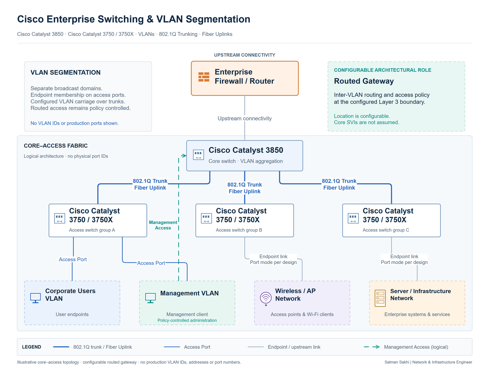

# Enterprise Cisco Switching & VLAN Segmentation

[**View Full Project on My Portfolio**](https://salman-sakhi.web.app/projects/cisco-switching-vlan-segmentation)

- **Engineering domain:** Enterprise Networking
- **Classification:** Production Experience
- **Lifecycle / verification scope:** Production Experience

## Technical objective

Support enterprise users, management devices, wireless services and business infrastructure through a segmented switching environment. The objective connects endpoint roles to clear VLAN boundaries, manageable uplinks and routed access, with practical fault isolation across physical connectivity, Layer 2 forwarding and Layer 3 dependencies.

## Infrastructure environment

The documented platform scope includes Cisco Catalyst 3850 and Cisco 3750/3750X switches in core and access roles. Enterprise endpoint groups depend on access ports, trunk links and fiber uplinks. The public record describes operational administration and simplifies the topology to avoid reproducing an organization's physical layout or internal addressing.

## Technologies and equipment

- Cisco Catalyst 3850
- Cisco 3750/3750X
- VLANs
- 802.1Q
- Inter-VLAN Routing
- Fiber & SFP

## My documented responsibilities

My documented work includes switch deployment, VLAN planning, management VLAN administration, 802.1Q trunks and access-port configuration. Operational responsibilities also cover routed connectivity, fiber/SFP links, cable fault testing and network diagnostics. MAC and ARP observations help connect endpoint symptoms to the relevant switch and network segment.

## Network or system architecture

*Sanitized logical architecture: a core switch connects distribution/access switches and endpoint groups. Device roles and uplinks explain the engineering model; labels do not establish an exact production inventory or physical layout.*

A VLAN separates a broadcast domain. Access between VLANs depends on the routing and filtering policy at the boundary. The diagram therefore describes logical connectivity rather than proving that every depicted group has an independently tested security policy.

## Implementation or troubleshooting approach

Begin with an endpoint's intended role, access port and VLAN membership. Review trunk carriage at both ends of the upstream link, then identify the routed boundary and permitted path beyond the local segment. This separates a missing Layer 2 path from a Layer 3 or service dependency.

For physical investigation, correlate link state and interface errors with the cable or fiber path. Consider transceiver compatibility and optical conditions where the equipment supports those observations. MAC learning, ARP information and uplink counters provide complementary evidence; none alone proves end-to-end application access.

## Operational challenges

An incorrect access VLAN, incomplete trunk carriage, a routing gap, a loop or a physical fault can produce similar user symptoms. Shared uplinks and management access also increase the impact of a change. The useful operational discipline is to narrow the affected layer and location before modifying a common dependency.

## Verification evidence

The current portfolio documents production responsibilities and an illustrative topology. It describes Layer 2/Layer 3 checks and provides example diagnostic commands, but publishes no switch configuration export, measured reliability result or dated acceptance output. More specific diagnostic details in the earlier outline remain supplemental notes requiring confirmation against the current scope.

These methods define what to inspect. They do not establish that a specific topology, isolation policy or recovery scenario passed testing.

## Outcome and current scope

This case study records production administration of segmented Cisco enterprise switching. The practical result documented publicly is an operational responsibility spanning endpoint ports, VLANs, trunks, routed boundaries and physical uplinks. It does not claim a quantified uptime improvement, a new campus deployment or an independently verified performance result.

## Related technical skills

VLAN planning, 802.1Q trunk review, access-port administration, inter-VLAN routing analysis, MAC/ARP investigation, fiber/SFP troubleshooting and physical-layer fault isolation.

## References

- [Current portfolio case study](https://salman-sakhi.web.app/projects/cisco-switching-vlan-segmentation) — canonical platform and responsibility scope.
- [Earlier technical notes](../cisco-enterprise-switching.md) — supplemental outline, including more specific diagnostic notes requiring confirmation.
- [GitHub profile](../../README.md)
