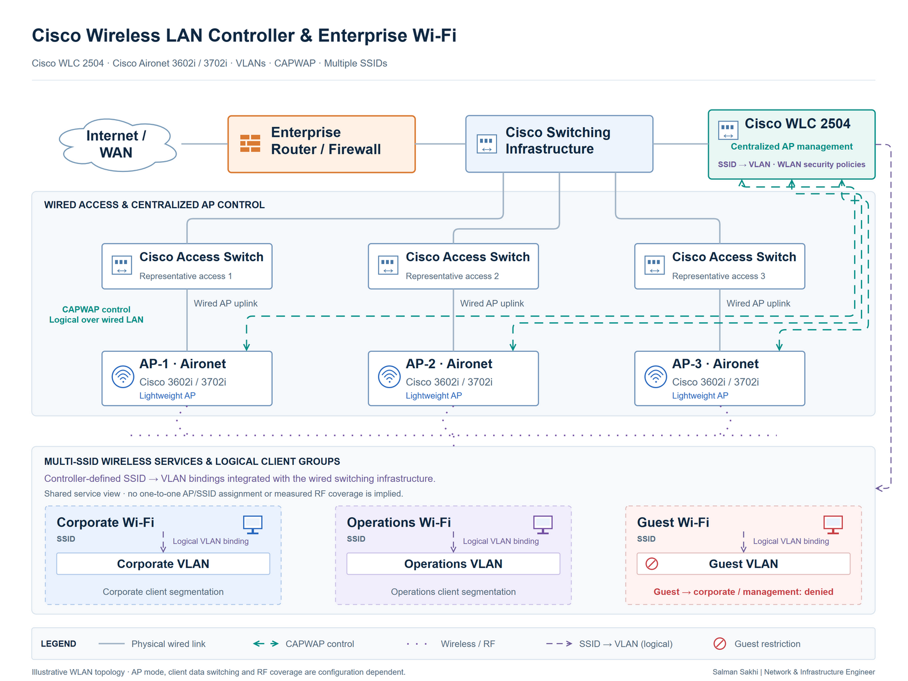

# Cisco Wireless LAN Controller & Enterprise Wi-Fi

[**View Full Project on My Portfolio**](https://salman-sakhi.web.app/projects/cisco-wlc-enterprise-wifi)

- **Engineering domain:** Wireless Networking
- **Classification:** Production Experience
- **Lifecycle / verification scope:** Production Experience

## Technical objective

Administer centralized enterprise wireless access for corporate users and guests while preserving the intended separation between services. The engineering scope connects SSID configuration, VLAN mapping, client controls and bandwidth policy with the wired network and the physical conditions affecting wireless access.

## Infrastructure environment

The documented platform scope is Cisco WLC 2504 with lightweight Cisco Aironet 3602i and 3702i access points. The appended professional record also places Cisco controller and lightweight-AP administration across manufacturing and office environments. It does not supply AP counts, floor area or measured roaming performance.

## Technologies and equipment

- Cisco WLC 2504
- Cisco Aironet 3602i
- Cisco Aironet 3702i
- SSIDs
- VLANs
- WLAN Policies

## My documented responsibilities

My documented responsibilities include controller management, AP registration, multiple SSIDs, VLAN integration, client restrictions and bandwidth policies. The operational scope also includes MAC-based administrative controls, AP placement considerations and RF troubleshooting. Client behavior is investigated across association, controller policy and the underlying network rather than treated as an isolated radio problem.

## Network or system architecture

*Illustrative wireless service architecture: Cisco WLC 2504 manages lightweight Aironet APs through the enterprise switching environment. Corporate and guest services show logical SSID/VLAN relationships. This is not a site survey, measured coverage map or detailed floor plan.*

Separate SSIDs contribute to service organization, while VLAN assignment and upstream policy determine the access boundary. Guest service also depends on addressing, name resolution and its permitted Internet path. The diagram alone does not verify isolation.

## Implementation or troubleshooting approach

Review AP registration and controller WLAN settings, then follow an affected client's service path through SSID association, VLAN assignment, address acquisition and upstream access. Compare the expected SSID-to-VLAN mapping with the wired path and relevant client policy.

RF investigation considers coverage, interference, channel use, physical obstructions and client distribution alongside controller observations. On-site conditions matter because a logical drawing cannot establish radio behavior. MAC filtering can support administration but does not provide strong identity assurance by itself.

## Operational challenges

A client may associate successfully yet lack useful access because of VLAN, DHCP, DNS or upstream policy problems. RF symptoms can also differ by location and device. Separating association from subsequent network services helps identify which dependency warrants a change, especially when corporate and guest access have different requirements.

## Verification evidence

The current record supports production administration of the stated platforms and supplies a logical topology. It describes checks for AP registration, SSID association, VLAN assignment, addressing and permitted access, but does not publish measured throughput, coverage, roaming, test captures or dated isolation results. Those checks are a validation method, not a list of passed tests.

The résumé extension does not establish WPA3 deployment or other features from a technology inventory alone. The earlier note's proposed throughput test remains a future evidence suggestion.

## Outcome and current scope

This case study documents centralized Cisco wireless management and separated WLAN administration. The practical scope spans RF and client association through switching, addressing and upstream services. No quantified coverage improvement, expanded AP inventory or independently verified performance outcome is claimed.

## Related technical skills

WLC administration, lightweight-AP registration, SSID/VLAN mapping, WLAN policy review, guest-access investigation, client troubleshooting, bandwidth controls and RF placement analysis.

## References

- [Current portfolio case study](https://salman-sakhi.web.app/projects/cisco-wlc-enterprise-wifi) — canonical platform scope and appended professional responsibilities.
- [Earlier technical notes](../cisco-wireless-controller.md) — supplemental outline and evidence suggestions.
- [GitHub profile](../../README.md)
