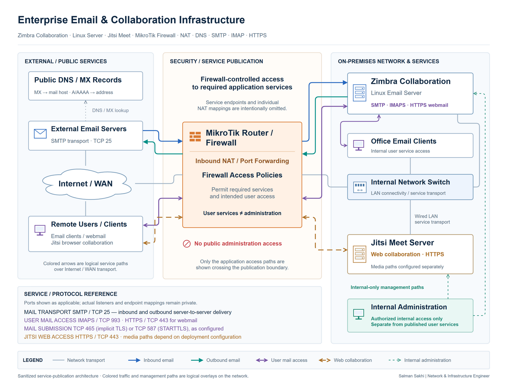

# Enterprise Email & Collaboration Infrastructure

[**View Full Project on My Portfolio**](https://salman-sakhi.web.app/projects/enterprise-email-collaboration)

- **Engineering domain:** Server Infrastructure
- **Classification:** Production Experience
- **Lifecycle / verification scope:** Production Experience

## Technical objective

Support on-premises enterprise communication services through server administration and controlled network access. Email and collaboration depend on more than a running application: DNS, listeners, routing, NAT and firewall policy all contribute to whether intended users can discover and use a service.

## Infrastructure environment

The current portfolio documents Zimbra email administration, Linux operations and Jitsi Meet infrastructure integration. Appended résumé sections add deployment and maintenance of Zimbra and Carbonio, including mail routing and spam filtering. These responsibilities do not establish that Carbonio shared the Linux host shown in the Zimbra/Jitsi illustration, and deployment-specific platform versions and host relationships are unspecified.

## Technologies and equipment

- Zimbra Collaboration
- Linux
- MikroTik
- NAT
- DNS
- Jitsi Meet
- Carbonio
- Spam Filtering
- SMTP Routing

## My documented responsibilities

My documented work covers email user and distribution-group administration, Linux server operations, collaboration infrastructure support and service-access troubleshooting. Network responsibilities include SMTP/IMAP connectivity and the NAT and firewall rules associated with mail access. The professional record also reports deploying and maintaining Zimbra and Carbonio platforms with mail-routing and spam-filtering responsibilities.

## Network or system architecture

*Sanitized service architecture showing clients reaching logical email and collaboration groups across a firewall-controlled boundary. Mail identities, service addresses, operational DNS records and internal application details are omitted. Carbonio administration is documented separately and is not depicted as co-hosted.*

The diagram explains functional relationships rather than exact port mappings, host counts, deployment versions or a redundant service design. Administrative access and externally published services require distinct treatment.

## Implementation or troubleshooting approach

Separate name resolution from network reachability before examining the server listener and application state. Compare the intended service path with DNS, NAT and firewall behavior, then correlate relevant logs with the affected protocol. Logs need to be interpreted without exposing account details or mail content.

SMTP transport, IMAP client access and collaboration traffic answer different operational questions. Mail investigation also distinguishes rejected or deferred messages from transport, filtering and client-configuration problems. A result for one function should not be generalized to the rest of the platform.

## Operational challenges

DNS inconsistencies, upstream restrictions, translation behavior, service configuration and server health can produce similar symptoms. A reachable server does not establish successful message handling, and a working client session does not independently verify delivery or filtering. Investigation needs to retain those distinctions while limiting published information about users and infrastructure.

## Verification evidence

The public evidence consists of the production administration narrative, the appended professional scope and an illustrative topology. It describes separate DNS, reachability, service-port and application checks, but supplies no configuration exports, mailbox records, dated diagnostic captures or individually verified incident outcomes.

Mailbox totals and availability percentages are not published. Earlier technical notes contain additional protocol and publication suggestions; they remain supplemental context rather than proof of a particular deployed configuration or completed test.

## Outcome and current scope

This case study records production support across server and network layers for enterprise communication infrastructure. The central engineering lesson is to trace dependencies and validate each protocol independently. The record does not claim a specific migration, co-hosting arrangement, redundant deployment or quantified improvement in availability or filtering.

## Related technical skills

Linux service operations, Zimbra/Carbonio administration, user and distribution management, DNS diagnosis, SMTP routing, spam-filter investigation, IMAP access troubleshooting, firewall/NAT review and collaboration-service integration.

## References

- [Current portfolio case study](https://salman-sakhi.web.app/projects/enterprise-email-collaboration) — canonical scope, including appended Zimbra and Carbonio responsibilities.
- [Earlier technical notes](../enterprise-email-collaboration.md) — supplemental service-access outline; no production configuration is inferred from it.
- [GitHub profile](../../README.md)
