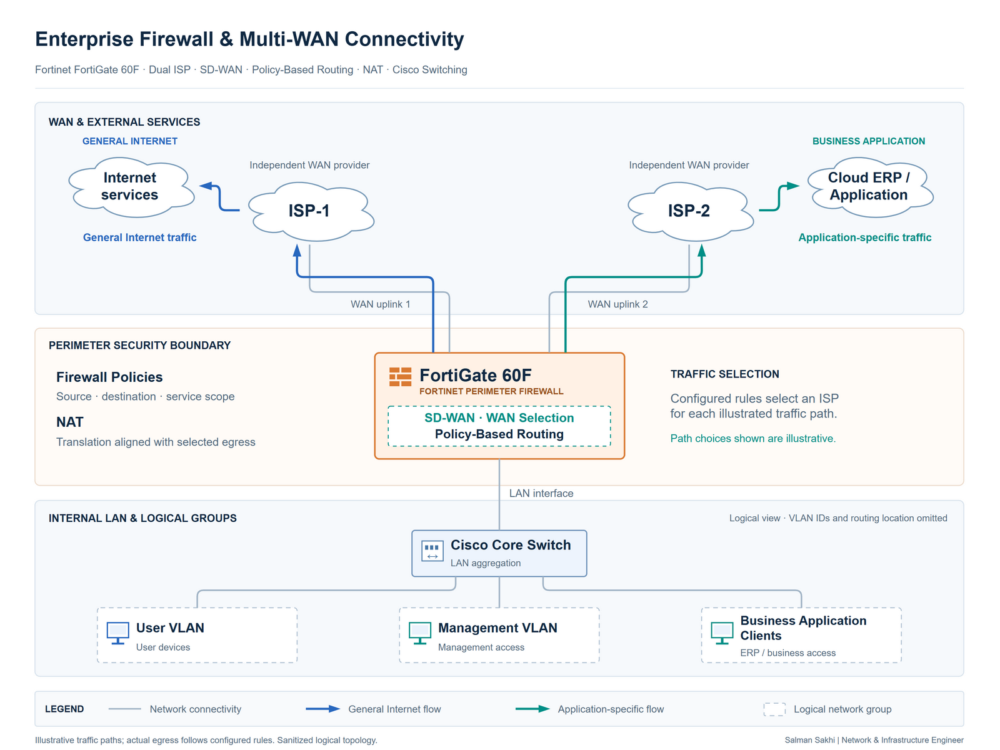

# Enterprise Firewall & Multi-WAN Connectivity

[**View Full Project on My Portfolio**](https://salman-sakhi.web.app/projects/enterprise-firewall-multi-wan)

- **Engineering domain:** Firewall & WAN
- **Classification:** Production Experience
- **Lifecycle / verification scope:** Production Experience

## Technical objective

Support enterprise Internet access and business-critical applications through a Fortinet perimeter with two independent ISP connections. The engineering requirement combines ordinary Internet use, SD-WAN session distribution and selective WAN routing for ERP and other business services. A usable application path depends on routing, policy and translation working together.

## Infrastructure environment

The documented environment includes enterprise LAN traffic behind a FortiGate 60F and parallel provider uplinks. The current portfolio also incorporates résumé-reported FortiGate high-availability administration. That separate HA responsibility does not establish the models, mode or topology of the cluster, or identify the illustrated 60F as an HA pair.

## Technologies and equipment

- Fortinet FortiGate 60F
- SD-WAN
- Policy Routing
- NAT
- Firewall Policies
- Fortinet FortiGate
- Dual ISP
- Traffic Rules
- Health Checks
- FortiGate HA
- Threat Protection

## My documented responsibilities

My documented work covers FortiGate firewall administration, dual-ISP SD-WAN load balancing, application-specific WAN selection, security policies and NAT. It also includes Internet connectivity investigation, route and gateway validation, and firmware-related troubleshooting and recovery planning. The appended résumé scope records HA clustering, site-to-site connectivity, access control and threat-protection administration.

## Network or system architecture

*Illustrative, sanitized architecture: the two providers are parallel uplinks to the firewall boundary. Internal addressing, provider identities and policy details are omitted. The separately reported HA cluster is not drawn.*

SD-WAN members represent available WAN paths; matching traffic rules determine their eligibility and selection. Distribution occurs across sessions or flows. The illustration does not imply that one connection combines both circuits' bandwidth.

## Implementation or troubleshooting approach

Follow the affected flow from client addressing to its upstream destination. Review the intended egress path, gateway state, selected route and SD-WAN or policy-routing decision before interpreting application behavior. Then correlate source, destination and service with the relevant firewall policy and source translation.

For distribution review, compare member state, rule matching, interface counters and representative independent flows. Firmware investigation requires configuration protection and a controlled recovery procedure. HA state, WAN member health and application access answer different operational questions.

## Operational challenges

Return-path symmetry, existing sessions, provider behavior and NAT can change the effect of a WAN-selection rule. Physical link state also differs from upstream service reachability. Health-check targets, thresholds, member weights and selection algorithms are deployment-specific and are not published in this case study.

## Verification evidence

The current public record supports production responsibilities and supplies an illustrative topology. It describes route, gateway, policy, counter and application checks; it does not publish configuration exports, captured test output or measured throughput, load ratios, HA failover or SD-WAN recovery times. Those methods define useful validation scope and are not presented as passed acceptance tests.

## Outcome and current scope

This case study documents production firewall security and multi-WAN administration. Its practical lesson is to assess the complete application path: link health, an active route and an allowed policy each explain only part of connectivity. Quantified resilience and security outcomes remain outside the public evidence.

## Related technical skills

Firewall policy review, SD-WAN traffic selection, policy routing, NAT analysis, gateway diagnostics, application-path troubleshooting, HA administration and maintenance recovery planning.

## References

- [Current portfolio case study](https://salman-sakhi.web.app/projects/enterprise-firewall-multi-wan) — canonical project scope, including appended résumé sections.
- [Earlier technical notes](../fortigate-multiwan.md) — retained supplemental outline and evidence suggestions.
- [GitHub profile](../../README.md)
