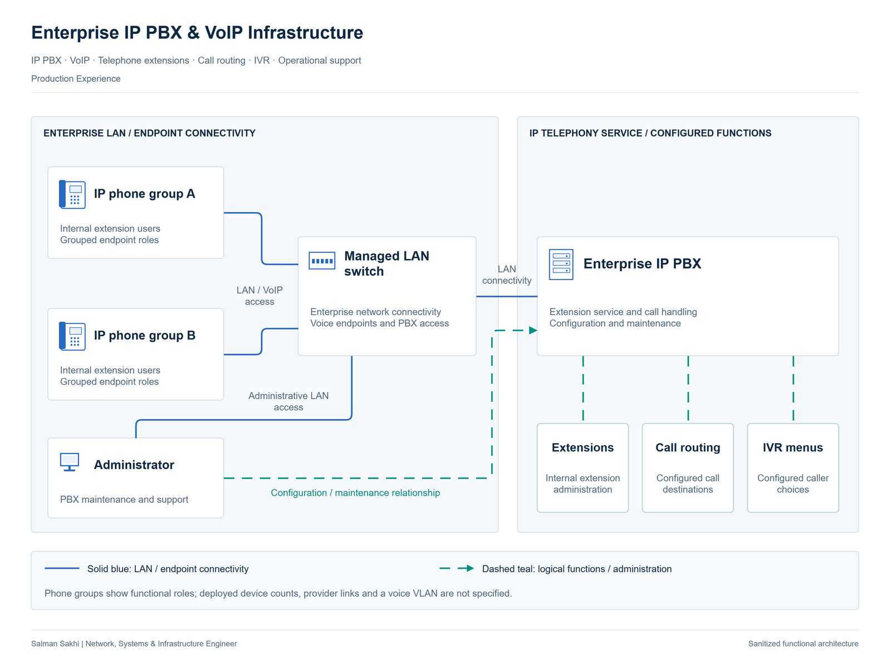

# Enterprise IP PBX & VoIP Infrastructure

[**View Full Project on My Portfolio**](https://salman-sakhi.web.app/projects/enterprise-ip-pbx-voip)

- **Engineering domain:** Telephony & Communication
- **Classification:** Production Experience
- **Lifecycle / verification scope:** Production Experience

## Technical objective

Administer enterprise telephone extensions, call routing and IVR behavior so calls reach their intended destinations. The operational objective combines understandable call handling with the network connectivity on which the PBX and endpoints depend. A useful investigation identifies the expected call path before choosing a configuration change.

## Infrastructure environment

The documented environment is an enterprise IP PBX/VoIP service connected through the organization's network. The PBX vendor, provider, endpoint models, extension count and external telephony connections are unspecified. SIP trunking appears in the wider skill inventory without a specific deployment record. This case does not infer a configured SIP trunk or voice VLAN.

## Technologies and equipment

- IP PBX
- VoIP
- Telephone Extensions
- Call Routing
- IVR
- Voice-Network Troubleshooting

## My documented responsibilities

I configured and maintained an IP PBX/VoIP system, including call routing and IVR menus. My administration scope also included telephone extensions and operational support for the service. These are the reported personal responsibilities; the public record does not identify a vendor-specific implementation, provider rollout or measured call-quality improvement.

## Network or system architecture

*Illustrative architecture. The PBX vendor and external telephony connections are unspecified; no SIP trunk or voice VLAN deployment is inferred.*

The logical architecture connects voice endpoints and extension groups through managed LAN switching to PBX call handling and administration. IVR menus represent configured caller choices, while routing directs communication toward the intended destination. The drawing communicates these service relationships without asserting an external provider design, trunk configuration or a deployed voice-segmentation topology.

## Implementation or troubleshooting approach

Start with the affected extensions, call direction and expected destination. Determine whether the symptom concerns endpoint connectivity, extension behavior, call routing or an IVR selection. Review network reachability separately from the PBX configuration that controls the call. A useful planned check follows the relevant call path and confirms that the selected menu or route reaches the intended destination. Such a check needs recorded observations before being described as a successful test.

## Operational challenges

A reachable PBX does not establish correct call routing, and a correct extension entry does not establish a healthy network path. Similar user symptoms can therefore arise from different parts of the service. Changes to menus or destinations also need to reflect the actual operational requirement. Network and call-handling observations should be compared before changing multiple settings at once.

## Verification evidence

The professional record supports IP PBX/VoIP configuration and maintenance, extension administration, call routing and IVR. This case supplies no call trace, configuration export, extension count, quality measurement or validated test-call result. Provider connectivity and trunk behavior require separate confirmation. The architecture illustrates the reported roles and does not prove a specific call topology or performance result.

## Outcome and current scope

The documented outcome is operational enterprise telephony administration covering extensions, routing and IVR. It provides a practical basis for discussing call-path troubleshooting and maintenance while keeping vendor, provider and external-connectivity details unspecified. There is no quantified improvement in voice quality or service availability to claim.

## Related technical skills

Related skills include IP PBX maintenance, VoIP support, extension management, IVR configuration and voice-network troubleshooting. SIP trunking familiarity should remain separate from a claim to have deployed a particular trunk in this environment.

## References

- [Full portfolio case study](https://salman-sakhi.web.app/projects/enterprise-ip-pbx-voip) — current project narrative and scope.
- [Professional profile](../../README.md) — related experience and technical skills.
