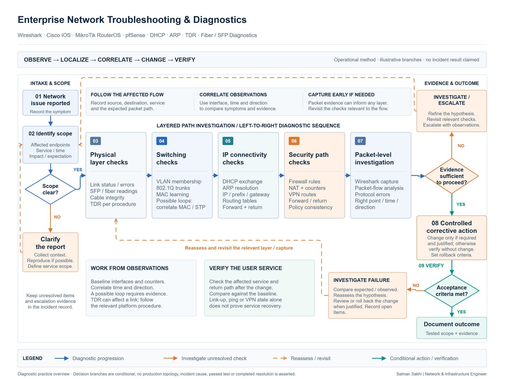

# Enterprise Network Troubleshooting & Diagnostics

[**View Full Project on My Portfolio**](https://salman-sakhi.web.app/projects/enterprise-network-troubleshooting)

- **Engineering domain:** Troubleshooting
- **Classification:** Production Experience
- **Lifecycle / verification scope:** Operational Troubleshooting

## Technical objective

My diagnostic work covers physical connectivity, switching, addressing, routing, firewall/NAT behavior, VPN paths, and network performance symptoms. These case notes explain a repeatable method: establish the symptom, follow the intended packet path, compare observations, and narrow the fault domain. They are a technical practice overview rather than a report of one incident with a single confirmed resolution.

## Infrastructure environment

The scope spans enterprise endpoints, switching, routed gateways and firewalls, upstream networks, and VPN-connected paths. Packet and device observations need to be interpreted within the relevant segment, interface, traffic direction, and time. The public record does not specify one unified deployment across every listed technology or publish production packet captures and device configuration.

## Technologies and equipment

- Wireshark
- Cisco IOS
- MikroTik RouterOS
- pfSense
- TDR
- SFP

## My documented responsibilities

My documented investigation topics include Wireshark DHCP analysis, ARP and MAC-table checks, Cisco cable diagnostics, SFP and optical-power troubleshooting, possible-loop investigation, Internet connectivity, firewall NAT, VPN routing, and interface-counter interpretation. I use these topics to explain how observations from different layers can support or reject a technical hypothesis. A possible cause remains a hypothesis until the available evidence supports it.

## Network or system architecture

*Illustrative diagnostic workflow: observations follow the client, access switch, routed gateway/firewall, and upstream path. Decision gates and verification loops represent investigative steps, not a specific customer's network or a completed incident timeline.*

Each observation belongs to a particular part of the path. A local forwarding check, route lookup, firewall decision, and application test answer different questions and should be correlated accordingly.

## Implementation or troubleshooting approach

For an addressing symptom, inspect where the expected DHCP exchange stops, then compare endpoint behavior with the relevant switch and gateway. ARP information and learned MAC addresses help relate the endpoint to its intended segment. Physical investigation considers link state, errors, cabling, transceiver compatibility, and available optical readings together.

For routed traffic, trace the intended direction and return path, then relate route selection to firewall policy and translation. VPN state is one observation within that wider path. For a suspected loop, correlate MAC learning, spanning-tree state, interface activity, and physical topology before changing links. Cable diagnostic procedures also need an appropriate operational process because their effect on a link depends on platform and conditions.

## Operational challenges

Similar user symptoms can arise at different layers. A capture without interface context or a counter without a time interval can mislead the investigation. Changing several variables at once can also obscure which explanation fits. Narrowing the fault domain and recording observations before interpretation keeps the reasoning testable and makes escalation clearer.

## Verification evidence

The portfolio documents diagnostic methods and case-note topics. It does not publish a complete incident evidence chain, measured fault reduction, or confirmed root cause for every topic. Relevant verification would compare observations before and after a justified change and check the affected user-facing service. A ping or one counter is insufficient by itself. These methods are not represented as passed tests or proof of a particular resolved incident.

## Outcome and current scope

This work records operational diagnostic experience across physical, switching, addressing, routing, and security layers. Its current public scope is the investigation method and the boundaries of each observation. A future incident-specific account would need a sanitized symptom, hypothesis, test, and supported resolution before presenting a confirmed finding.

## Related technical skills

Packet analysis, DHCP and ARP investigation, MAC-table interpretation, physical-link diagnostics, optical troubleshooting, route and NAT analysis, VPN packet-path reasoning, counter interpretation, and evidence-based incident documentation.

## References

- [Current portfolio case study](https://salman-sakhi.web.app/projects/enterprise-network-troubleshooting)
- [Preserved detailed project notes](../network-troubleshooting.md)
- [GitHub profile and project index](../../README.md)
