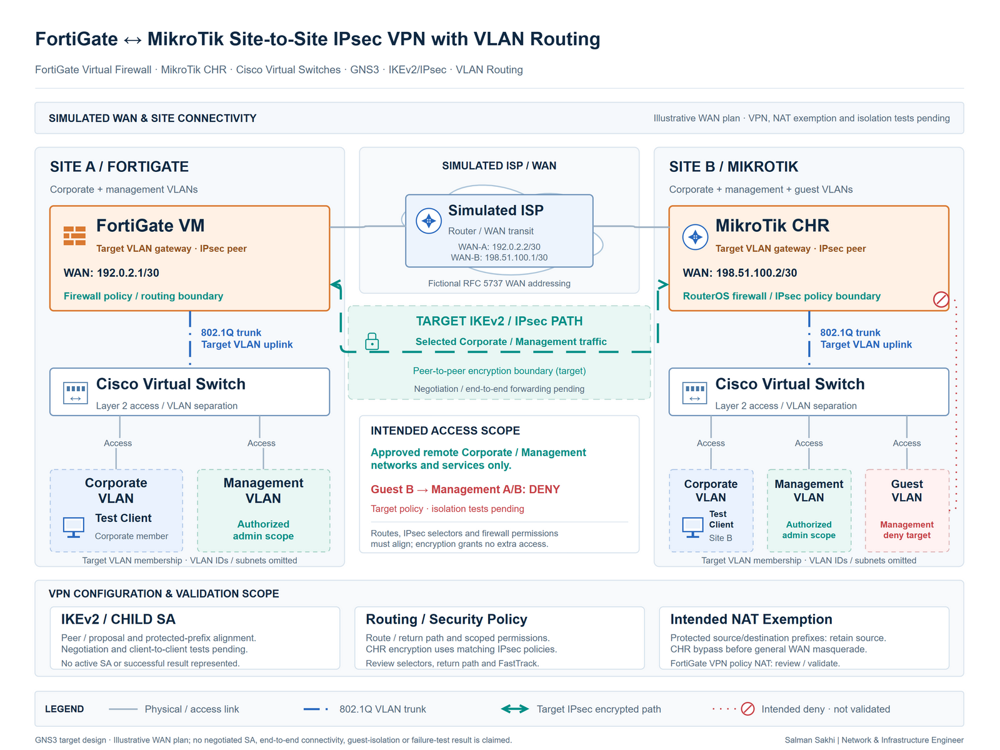

# FortiGate ↔ MikroTik IPsec VPN with VLAN Routing

[**View Full Project on My Portfolio**](https://salman-sakhi.web.app/projects/fortigate-mikrotik-ipsec-vlan-lab)

- **Engineering domain:** Advanced VPN Lab
- **Classification:** Technical Lab
- **Lifecycle / verification scope:** Lab in Progress

## Technical objective

Develop a GNS3 interoperability lab for FortiGate and MikroTik with encrypted inter-site connectivity and routed VLANs. The target combines corporate, management and guest segments, simulated Internet connectivity, explicit security rules and NAT exemption. End-to-end VPN functionality and security acceptance remain pending validation.

## Infrastructure environment

This is a virtual technical lab designed to resemble enterprise requirements. The target environment includes a FortiGate virtual firewall, MikroTik CHR, Cisco virtual switching and a simulated Internet path. The current record does not establish production deployment, a completed tunnel or successful guest isolation.

## Technologies and equipment

- FortiGate Virtual Firewall
- MikroTik CHR
- GNS3
- Cisco Virtual Switches
- IKEv2/IPsec
- VLANs

## My documented responsibilities

My ongoing lab work spans the virtual network, segmented site networks, IPsec configuration and access controls. The documented workstream includes underlay preparation, VLAN connectivity and routing definitions, followed by IKEv2/IPsec settings, security policies and NAT-exemption review. These are implementation stages with separate acceptance checks; their inclusion is not evidence that each stage has passed.

## Network or system architecture

*Illustrative target architecture for an in-progress lab. The FortiGate and MikroTik sites connect through a simulated Internet environment. VLAN routing, end-to-end VPN carriage, guest isolation and failure behavior remain unverified.*

Corporate, management and guest segments represent different access requirements. An encrypted path must preserve those distinctions, including where a segment must be denied access to another network. The topology explains the design scope rather than presenting observed traffic or accepted security results.

## Implementation or troubleshooting approach

The workstream separates underlay reachability from tunnel negotiation, routed traffic and access restrictions. Establish the intended virtual links and network paths first. Then align cross-platform IKE/IPsec settings and traffic selectors with the remote networks that should traverse the encrypted path.

Review static routing, firewall rules, NAT exemption and return paths together. For each segment, define permitted source, destination and service combinations before testing. Corporate connectivity, management restrictions and guest isolation need distinct criteria, followed by explicit checks for unavailable-path behavior.

## Operational challenges

Cross-vendor settings, selectors, routing and NAT order need to agree. A negotiated tunnel would still leave traffic carriage and policy isolation to verify. Each additional VLAN increases the number of allowed and denied paths to assess, so a small set of successful pings cannot establish completion of the whole design.

## Verification evidence

The canonical portfolio explicitly labels the lab in progress and states that end-to-end operation, isolation and failure testing are pending. No acceptance output, packet captures or verified tunnel-state evidence is published. The planned checks include IKE/IPsec state on both platforms, bidirectional permitted traffic, NAT exemption, return routing and denied guest paths.

Earlier technical notes are retained for continuity. Addressing and underlay preparation are not treated as verified milestones without supporting evidence in the current record.

## Outcome and current scope

The current outcome is an active lab with a defined target architecture and validation scope. The next documented milestone is verified end-to-end IPsec connectivity, followed by isolation and failure tests. No successful production VPN, resilience result or security acceptance is claimed.

## Related technical skills

GNS3 topology design, virtual firewall/router preparation, IKEv2/IPsec interoperability, VLAN routing, NAT exemption, access-policy design and staged acceptance planning.

## References

- [Current portfolio case study](https://salman-sakhi.web.app/projects/fortigate-mikrotik-ipsec-vlan-lab) — canonical in-progress status and pending validation scope.
- [Earlier technical notes](../fortigate-mikrotik-gns3.md) — retained supplemental lab outline and validation considerations.
- [GitHub profile](../../README.md)
