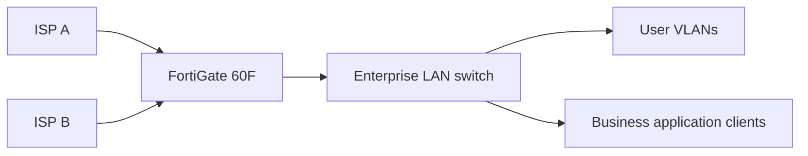

# FortiGate Enterprise Firewall & Multi-WAN Connectivity

[**View full project on SalmanSakhi.com →**](https://salman-sakhi.web.app/projects/enterprise-firewall-multi-wan)

**Status:** Production experience — infrastructure administration  
**Technologies:** Fortinet FortiGate 60F, SD-WAN, firewall policies, NAT, policy-based routing, dual ISP  
**Focus:** Firewall operations, resilient WAN design and application-specific connectivity

## Business requirement

Support enterprise connectivity with multiple upstream Internet links while controlling which path selected applications use. Keep internal networks protected behind appropriate firewall and NAT policies and support day-to-day troubleshooting.

## Architecture (sanitized, illustrative)

*Logical illustration only; not a copy of a company network.*

## Engineering activities

- Administration of FortiGate interfaces, addressing, routes and policies.
- Handling dual-WAN connectivity and policy-based path selection for business-critical services.
- Reviewing source NAT and security policies alongside routing decisions.
- Investigating application reachability when a specific ISP path is required.
- Troubleshooting firmware-related behavior with a controlled recovery approach.

## Technical considerations

A policy-routing or SD-WAN change is only valid when the relevant firewall policy, NAT behavior, return path and gateway health are consistent. Test both regular Internet access and application-specific traffic rather than treating a successful ping as complete validation.

## Evidence to add

- Redacted interface and route summaries.
- Sanitized policy-routing logic or a synthetic lab recreation.
- Verification captures showing intended WAN selection.
- Change-control/test checklist.

**Disclosure:** The narrative describes professional responsibilities; no customer configuration, private addresses, secrets or measured performance claims are published.

[Back to profile](../README.md)
