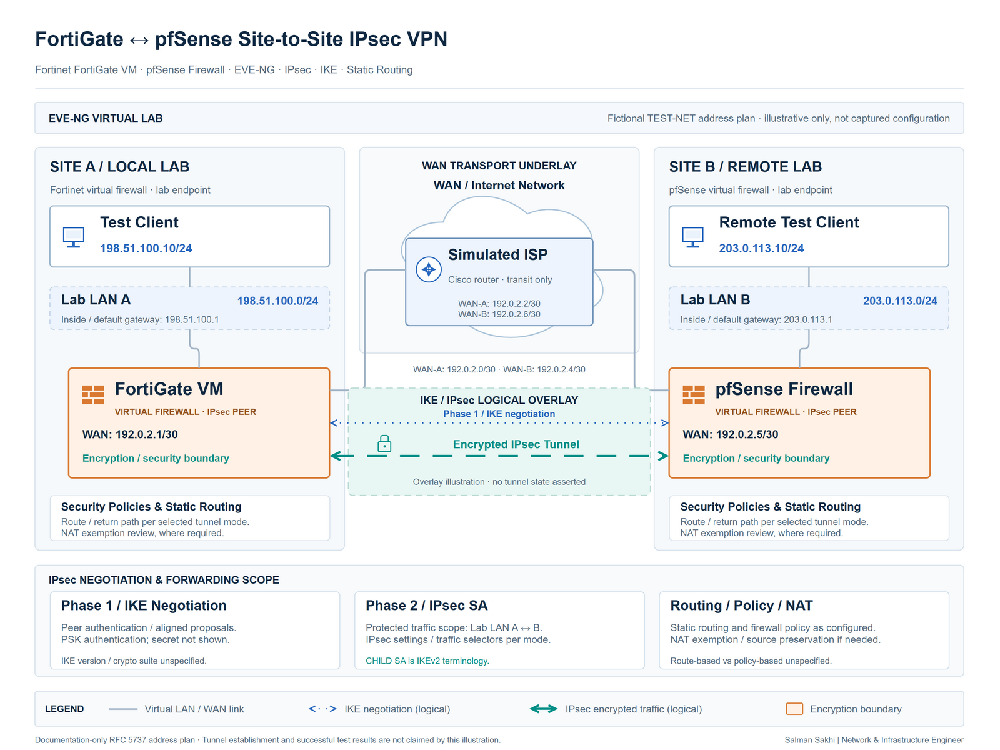

# FortiGate ↔ pfSense IPsec VPN Lab

[**View Full Project on My Portfolio**](https://salman-sakhi.web.app/projects/fortigate-pfsense-ipsec-lab)

- **Engineering domain:** Firewall & VPN Lab
- **Classification:** Completed Lab
- **Lifecycle / verification scope:** Completed Lab

## Technical objective

I completed a virtual site-to-site IPsec lab to explore interoperability between FortiGate and pfSense. The learning objective was to connect two local networks across a simulated ISP while aligning tunnel negotiation, static routing, and firewall policies across different platforms. This was a controlled learning environment, with its completion reported in the public portfolio record.

## Infrastructure environment

The lab used EVE-NG with a FortiGate firewall, a pfSense firewall, and a Cisco router representing the ISP. Local test networks sat behind the firewalls. This simulated underlay made it possible to consider peer transport separately from protected inter-site traffic. The public record does not specify software versions, addressing, encryption proposals, virtual resource sizing, or the selected tunnel mode.

## Technologies and equipment

- Fortinet FortiGate
- pfSense
- Cisco ISP Router
- EVE-NG
- IPsec

## My documented responsibilities

My completed lab scope covered the virtual two-site arrangement, simulated ISP connectivity, IPsec Phase 1 and Phase 2 configuration with pre-shared-key authentication, static routing, firewall policies, and inter-site reachability verification. I used the exercise to connect cross-vendor settings with the packet path they were intended to support. Authentication material and configuration exports are not included here.

## Network or system architecture

*Illustrative lab architecture: test LAN → FortiGate → simulated ISP → pfSense → test LAN. The diagram explains the virtual two-site arrangement; configuration and test artifacts remain pending review.*

The simulated ISP is the transport between peers. Each firewall also controls the traffic exchanged between its local network and the remote network, so tunnel negotiation and endpoint access are separate parts of the lab.

## Implementation or troubleshooting approach

The configuration approach begins with peer reachability over the simulated underlay. Phase 1 and Phase 2 settings then need deliberate comparison across the two platforms, including authentication and the intended local and remote traffic definitions. Routing and policy review must fit the selected tunnel mode rather than assume that equivalent-looking menus have identical effects.

For protected traffic, the relevant path includes route selection, local and remote definitions, security policy, return routing, and any NAT interaction. An established security association answers a negotiation question; endpoint checks address whether the intended traffic can traverse the complete lab path.

## Operational challenges

Different platform terminology can obscure equivalent IPsec settings. Transport reachability and protected-network reachability can also fail independently. Keeping those fault domains separate makes it easier to interpret negotiation state without overlooking routing or filtering. This lab context does not establish production capacity, resilience, or suitability for a particular deployment.

## Verification evidence

The latest public record identifies this as a completed EVE-NG lab and includes inter-site reachability verification in its scope. Configuration and test evidence are pending review. I therefore report the completed lab without supplying invented tunnel outputs, screenshots, packet captures, or pass counts. Reviewing tunnel state on both peers and evaluating endpoint reachability are the stated validation methods; no specific live output or measured result is published here.

## Outcome and current scope

The completed exercise brought together cross-platform IPsec configuration, simulated ISP connectivity, routing, policies, and inter-site checks. Its value is practical understanding of how negotiation and permitted traffic relate. The current documentation supports that learning scope while leaving detailed configuration review and artifact-backed reproduction for a future evidence update.

## Related technical skills

Cross-vendor firewall configuration, IPsec Phase 1/Phase 2 comparison, static routing, security-policy review, virtual network labs, packet-path reasoning, and separation of tunnel state from service reachability.

## References

- [Current portfolio case study](https://salman-sakhi.web.app/projects/fortigate-pfsense-ipsec-lab)
- [Preserved detailed project notes](../fortigate-pfsense-ipsec-lab.md)
- [GitHub profile and project index](../../README.md)
