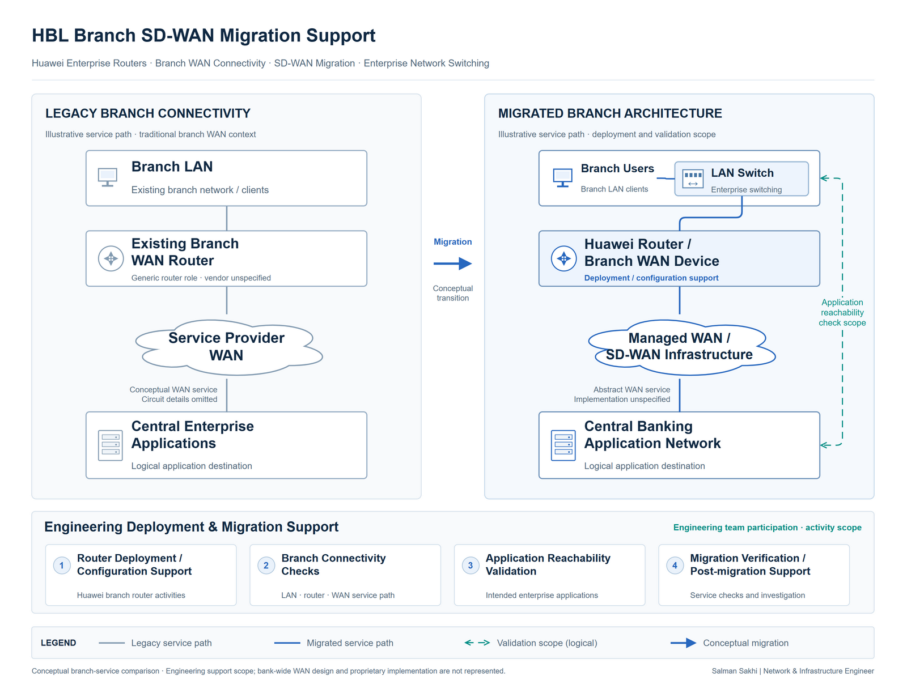

# HBL Branch SD-WAN Migration Support

[**View Full Project on My Portfolio**](https://salman-sakhi.web.app/projects/hbl-branch-sd-wan-migration)

- **Engineering domain:** WAN & Branch Connectivity
- **Classification:** Production Experience
- **Lifecycle / verification scope:** Production Experience

## Technical objective

My contribution was to support HBL branch SD-WAN migration activities as part of the engineering delivery team during my Jaffer Business Systems role. The objective was to connect router deployment and migration tasks with checks of branch connectivity and required application access. Branch service readiness needs attention to the complete access path, beyond the state of an individual router interface.

## Infrastructure environment

The environment was a banking branch network connected through an enterprise WAN. My documented work concerns branch equipment and migration support within that wider environment. The public record does not identify carrier arrangements, SD-WAN controller details, production addressing, router models, or the bank's complete WAN topology. Those details are outside this case study.

## Technologies and equipment

- Huawei Routers
- Enterprise WAN
- Branch Networking
- SD-WAN Migration

## My documented responsibilities

I participated in branch router installation, Huawei configuration support, coordinated migration activities, branch connectivity tests, application reachability validation, and post-migration troubleshooting. I carried out these responsibilities within the engineering team. This describes my deployment and validation contribution; it does not assign me ownership of the bank's WAN architecture or the bank-wide migration program.

## Network or system architecture

*Illustrative architecture: branch LAN → Huawei branch router → enterprise WAN → logical application destination. The conceptual legacy and migrated paths explain the migration context without disclosing banking topology or operational configuration.*

The illustration identifies where local connectivity, WAN forwarding, and application access need separate investigation. It does not specify the implementation of the enterprise WAN or imply a particular controller platform.

## Implementation or troubleshooting approach

The documented work links physical installation to configuration support and service checks. An orderly approach establishes the branch's agreed migration scope, checks local connectivity and the router path, then evaluates access to the intended application destination. These are representative engineering steps rather than a disclosed cutover runbook.

For troubleshooting, the useful distinction is between a local endpoint or LAN symptom and a router, WAN, access-policy, or application symptom. Recording the affected service and observations gives the responsible team a clearer escalation point. Any recovery or handover procedure remains subject to the team's agreed migration arrangements.

## Operational challenges

Migration changes can interact with addressing, route selection, policy, and application dependencies. A healthy link alone does not establish that branch users can reach their business services. Team coordination also matters: installation, WAN changes, application checks, and escalation may have different owners. Clear observations help avoid attributing every post-change symptom to the migration.

## Verification evidence

The public project record documents branch connectivity testing and application reachability validation as part of my role. It does not publish per-branch acceptance records, command outputs, timing measurements, or application test logs. The check sequence described here explains the validation scope; it is not a claim that every possible migration test passed or that service interruption was measured.

## Outcome and current scope

This case study records production experience supporting a banking branch migration program through Huawei router deployment, configuration assistance, and connectivity validation. My contribution remains bounded by engineering-team participation. No branch count, bank-wide rollout result, availability improvement, or migration-performance figure is claimed.

## Related technical skills

Branch router installation, enterprise WAN troubleshooting, configuration support, layered connectivity checks, application-path validation, technical escalation, and coordinated migration support.

## References

- [Current portfolio case study](https://salman-sakhi.web.app/projects/hbl-branch-sd-wan-migration)
- [Preserved detailed project notes](../hbl-branch-sdwan-migration.md)
- [GitHub profile and project index](../../README.md)
