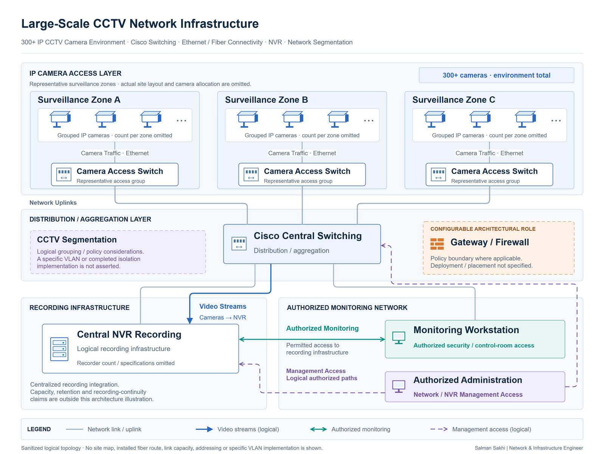

# Large-Scale CCTV Network Infrastructure

[**View Full Project on My Portfolio**](https://salman-sakhi.web.app/projects/large-scale-cctv-network)

- **Engineering domain:** Network Infrastructure & Surveillance
- **Classification:** Production Experience
- **Lifecycle / verification scope:** Production Experience

## Technical objective

Operate and support the network connecting more than 300 IP CCTV cameras to associated recording infrastructure. The requirement is dependable camera-to-recorder connectivity with manageable addressing, switching and uplink relationships. This production operations case is separate from the portfolio's proposed perimeter-fiber design and its CCTV isolation work still in progress.

## Infrastructure environment

The documented environment is a large IP surveillance network using cameras, NVR systems and switching, with fiber representing transport between distribution functions. The 300+ camera scale is stated in the current canonical record. Camera models, physical security locations, exact switch populations and recording-capacity figures are not published.

## Technologies and equipment

- IP Cameras
- NVR
- Cisco
- VLANs
- Fiber
- Switching

## My documented responsibilities

My documented role covers camera network addressing, NVR integration, switching operations, camera connectivity troubleshooting and routine network maintenance. The work includes examining switch ports and uplinks when cameras become unreachable, and considering segmentation and operational security alongside the recording path.

## Network or system architecture

*Sanitized logical architecture grouping representative cameras behind distribution switches and centralized recording infrastructure. Fiber and switching show transport relationships; the drawing does not reveal actual security locations, exact device counts per switch or production addresses.*

The number of illustrated camera symbols represents groups rather than the installed inventory. Camera traffic, management access and the recording destination have related but distinct access requirements. The topology does not establish completed isolation for the separate in-progress CCTV segmentation project.

## Implementation or troubleshooting approach

Follow the affected camera's address, physical connection, access port, logical segment and upstream path toward the recorder. Compare an isolated camera failure with the scope of other affected devices to identify a shared switch or uplink dependency. Review link and interface conditions before making changes to common switching infrastructure.

A failed view also requires attention to the recording service, rather than an immediate conclusion that the network is at fault. Camera-to-NVR reachability is one check; recording continuity and retention need application and storage assessment beyond basic connectivity.

## Operational challenges

Many camera streams can share uplinks and recording destinations. Capacity assessment therefore depends on stream settings, traffic patterns, link speeds and NVR requirements. The current source does not supply those inputs, so it supports bandwidth and interface-utilization review without establishing a bitrate, retention period or recorder capacity.

Physical connectivity, addressing, permitted paths and recording-service state can fail independently. Narrowing the layer and affected scope helps avoid an unnecessary shared-network change.

## Verification evidence

The public record reports operational experience in a 300+ camera environment and provides an illustrative topology. It describes camera addressing, camera-to-recorder reachability, switch connectivity and uplink checks. No captured device output, recording-continuity result, storage assessment or dated acceptance report is published.

The older flat document combines production operations with separate fiber design/planning and mentions additional equipment considerations. It is retained as a supplemental reference; its proposed construction and design details are not treated as installed infrastructure or completed validation here.

## Outcome and current scope

This case study documents hands-on support of a large surveillance network. Its scope is network operations and fault isolation across distributed cameras and centralized recording. It does not claim that a perimeter proposal was built, that CCTV isolation is complete, or that a quantified recording or availability improvement was achieved.

## Related technical skills

Camera addressing, NVR connectivity support, switching diagnostics, uplink investigation, VLAN-aware segmentation review, fiber transport analysis and fault isolation across network and recording dependencies.

## References

- [Current portfolio case study](https://salman-sakhi.web.app/projects/large-scale-cctv-network) — canonical production operations scope and stated camera scale.
- [Earlier technical notes](../cctv-fiber-infrastructure.md) — supplemental combined outline; design/planning material remains separate.
- [GitHub profile](../../README.md)
