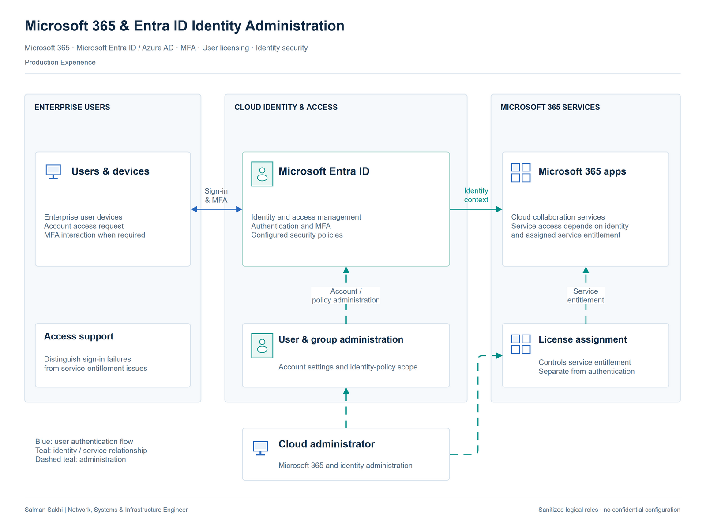

# Microsoft 365 & Entra ID Identity Administration

[**View Full Project on My Portfolio**](https://salman-sakhi.web.app/projects/microsoft-365-entra-identity-administration)

- **Engineering domain:** Microsoft Cloud & Identity
- **Classification:** Production Experience
- **Lifecycle / verification scope:** Production Experience

## Technical objective

Support users' access to Microsoft 365 through appropriate licensing, cloud identity administration and authentication requirements. The objective is to connect the service a user needs with the account and security conditions that allow access. Licensing and authentication each require investigation because their symptoms can appear similar to the user.

## Infrastructure environment

The documented environment is Microsoft 365 with Azure Active Directory, now Microsoft Entra ID. The case concerns cloud identity and service administration. Tenant identifiers, user counts, license tiers and a directory-synchronization architecture are unspecified. No hybrid identity deployment, on-premises synchronization component or tenant migration is inferred from the cloud-administration responsibilities.

## Technologies and equipment

- Microsoft 365
- Azure AD / Microsoft Entra ID
- User Licensing
- Multifactor Authentication
- Identity Security Policies

## My documented responsibilities

I administered Azure Active Directory and Microsoft 365 services, managed licenses and security policies, and implemented multifactor authentication. My documented scope includes Microsoft 365 administration, cloud identity security-policy administration and authentication support. The record does not identify a particular policy product, named policy configuration or detailed tenant design.

## Network or system architecture

*Illustrative architecture. Cloud identity and service-administration roles are shown without tenant identifiers, license tiers or hybrid directory synchronization.*

The logical architecture relates users, Microsoft 365 service access, cloud identity, MFA, licensing and administration. Each represents a separate contribution to the access path. The diagram does not publish tenant or account information and does not depict hybrid directory synchronization. A functional relationship between identity and services is sufficient to explain the support scope.

## Implementation or troubleshooting approach

First identify the affected account and service within the authorized support context. Distinguish sign-in failure from missing service entitlement, then review the relevant authentication requirement and account state. Changes should match delegated administrative access and the organization's security policy. Review endpoint and application symptoms in relation to the cloud service rather than assume every access problem has the same cause. These steps describe an investigation method, not a new validated incident record.

## Operational challenges

Account status, licensing and authentication can independently prevent access. Resolving one condition may leave another service requirement outstanding. Investigation should narrow the affected condition without disclosing user records or weakening authentication controls to bypass a symptom. Clear boundaries between tenant policy, service entitlement and endpoint behavior make the next administrative action easier to justify.

## Verification evidence

The professional record reports Microsoft 365 and Azure AD administration, license management, security policies and MFA implementation. It supplies no tenant export, named license tier, user count, validation log or measured availability result. A completed identity-synchronization rollout, migration, certification or quantified security improvement is not established. The architecture is explanatory evidence of scope rather than a tenant configuration export.

## Outcome and current scope

The case records production cloud identity and Microsoft 365 service responsibilities, with licensing, MFA and access support as the practical focus. Detailed tenant configuration and deployment-specific outcomes remain subject to separate evidence. Azure AD and Microsoft Entra ID naming describes the same cloud identity platform in this record.

## Related technical skills

Related skills include service-entitlement review, Microsoft 365 administration, cloud identity support, MFA and identity security-policy administration. The engineering emphasis is diagnosing the specific condition affecting access while maintaining the organization's authentication requirements.

## References

- [Full portfolio case study](https://salman-sakhi.web.app/projects/microsoft-365-entra-identity-administration) — current project narrative and scope.
- [Professional profile](../../README.md) — related experience and technical skills.
