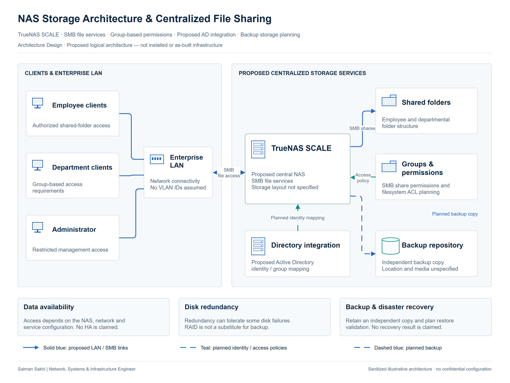

# NAS Storage Architecture & Centralized File Sharing

[**View Full Project on My Portfolio**](https://salman-sakhi.web.app/projects/nas-centralized-file-storage-design)

- **Engineering domain:** Storage Architecture
- **Classification:** Architecture Design
- **Lifecycle / verification scope:** Design / Planning

## Technical objective

Design a managed access point for employee and departmental files using a proposed TrueNAS SCALE SMB service. The objective is to organize shared data, ownership and access rules while treating availability and recoverability as separate requirements. The deliverable is an architecture proposal, with implementation decisions still open.

## Infrastructure environment

Clients would access the NAS through an enterprise LAN. The proposal includes employee and departmental share roles and a separate backup-storage role. Hardware, usable capacity, disk layout, network speed and deployment location remain design inputs. Active Directory integration is optional where an existing compatible directory and its operating requirements are available.

## Technologies and equipment

- TrueNAS SCALE
- NAS
- SMB
- File ACLs
- Active Directory Integration
- Backup Storage

## My documented responsibilities

My documented scope is the centralized-storage design study: defining the relationship between SMB shares, permission groups, optional directory integration and backup planning. The record supports architecture discussion and proposed validation criteria. It does not document installation of TrueNAS, a domain join, storage provisioning or a completed production handover.

## Network or system architecture

*Illustrative architecture. Proposed architecture — not as-built. RAID is not a substitute for backup.*

The illustration connects authorized LAN clients to logically separated employee and departmental folders on a proposed NAS. Group-based permissions govern access; optional directory integration provides an identity relationship rather than an implemented configuration. A separate backup-storage role represents recovery planning. The picture does not select a RAID layout, specific VLAN implementation or physical storage platform.

## Implementation or troubleshooting approach

Start by agreeing what data belongs in each share and who owns it. Define read, modify and administrative access through appropriate groups, then review share permissions and file-system ACLs together, including inheritance. If directory integration is selected, review DNS, time and directory dependencies. Before acceptance, plan permitted and denied access checks, storage-health review and a separate restoration exercise.

## Operational challenges

Centralized access requires consistent ownership and permission decisions, especially where departmental and employee folders have different needs. Disk redundancy can address some device failures but cannot replace backup protection against deletion, compromise or a site incident. A snapshot or dataset on the same NAS is not an independent disaster-recovery copy. Backup location, retention and access protection therefore need explicit decisions.

## Verification evidence

The evidence is a proposed architecture only. No installed NAS, directory integration, hardware specification, capacity measurement, transfer-speed result or restore test is recorded. Access tests, redundancy behavior and recovery validation are future acceptance activities after a real environment is defined. The diagram's backup relationship is a design intention, not evidence of a running replication or backup job.

## Outcome and current scope

The current outcome is an illustrative centralized-file-service design with clear implementation questions. Workload sizing, hardware suitability, identity ownership, backup placement and recovery requirements remain to be agreed. It carries no availability promise or recovery-time guarantee and remains proposed infrastructure.

## Related technical skills

Related skills include SMB architecture, file ACL planning, group-based access design and the distinction between redundancy and backup. Active Directory integration appears as a design consideration; this case does not establish completed domain-integration experience.

## References

- [Full portfolio case study](https://salman-sakhi.web.app/projects/nas-centralized-file-storage-design) — current project narrative and scope.
- [Professional profile](../../README.md) — related experience and technical skills.
