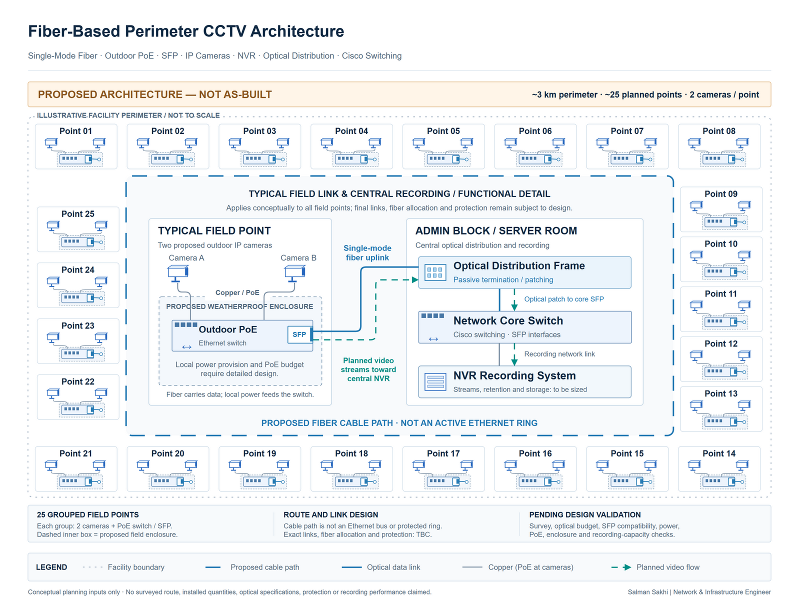

# Fiber-Based Perimeter CCTV Architecture

[**View Full Project on My Portfolio**](https://salman-sakhi.web.app/projects/perimeter-fiber-cctv-design)

- **Engineering domain:** Network Design
- **Classification:** Network Architecture Design
- **Lifecycle / verification scope:** Design / Planning

## Technical objective

My design work concerns a proposed fiber-connected CCTV network for an approximately 3 km perimeter. The planning inputs are approximately 25 field points with two planned cameras per point. The objective is to connect surveillance placement with fiber distribution, outdoor switching and power, and centralized recording requirements before equipment selection and deployment.

## Infrastructure environment

The proposed environment combines distributed outdoor camera locations with a central recording location. Field enclosures, PoE switching, single-mode fiber transport, optical distribution, and NVR/storage planning form part of the design scope. Perimeter length, field-point quantities, and camera placement are proposed inputs, subject to site survey and review. They are not an installed inventory or an as-built description.

## Technologies and equipment

- Single-Mode Fiber
- SFP
- PoE Switches
- CCTV
- NVR
- Optical Distribution

## My documented responsibilities

My planning scope includes fiber and outdoor connectivity, field enclosures, PoE switching, NVR/storage requirements, a bill of quantities, and vendor-based material categorization. I am relating proposed field-point requirements to the optical, electrical, recording, and maintenance decisions needed for a deployable design. Final component selection depends on confirmed site requirements and compatibility checks.

## Network or system architecture

*Illustrative planning architecture: distributed camera points and field switches connect through a proposed fiber path to central recording. A loop-shaped fiber route does not establish ring redundancy, automatic failover, or a validated protection design.*

The proposed requirement for two SFP uplinks at each field point needs confirmation alongside compatible optics and fiber allocation. Physical route, topology selection, field placement, and protection behavior remain design-review items. The diagram communicates relationships rather than a completed installation.

## Implementation or troubleshooting approach

The planning approach maps field-point connectivity and optical distribution needs, then checks how enclosure access, power provision, PoE load, and environmental exposure affect material choices. A traceable bill of quantities keeps each item tied to a technical function and a current design assumption.

Detailed feasibility work needs route lengths, connector and splice allowances, optical budgets, and SFP compatibility. Recording capacity depends on selected camera specifications, stream settings, retention requirements, and operational needs. Those inputs must be confirmed before deriving final link, power, bandwidth, or storage figures. No capacity calculation is presented as complete here.

## Operational challenges

Outdoor surveillance infrastructure joins several dependencies: physical routing, power, termination, switching, recording, and maintainability. A route or field-point change may alter fiber allocation, enclosure contents, and material quantities at the same time. A redundant service also requires an appropriate topology and protection mechanism; drawing a fiber loop alone cannot establish resilience.

## Verification evidence

The evidence scope is design and planning. Survey confirmation, detailed optical calculations, power and capacity checks, component compatibility, and material verification remain pending design validation. The proposed two-uplink field arrangement is part of that review. Installation acceptance and commissioning would follow deployment. None of these planning checks is presented as a passed commissioning test, and no installed-camera count, optical test result, or failover result is claimed.

## Outcome and current scope

The current outcome is a proposed perimeter CCTV architecture and associated material-planning scope. It provides a basis for survey, equipment review, and procurement preparation. Progress to implementation depends on validating site assumptions and the optical, electrical, environmental, and recording requirements that drive the design.

## Related technical skills

Fiber network planning, optical distribution, SFP compatibility review, outdoor enclosure and power considerations, PoE sizing principles, CCTV recording requirements, material categorization, and traceable design assumptions.

## References

- [Current portfolio case study](https://salman-sakhi.web.app/projects/perimeter-fiber-cctv-design)
- [Preserved detailed project notes](../perimeter-fiber-cctv-design.md)
- [GitHub profile and project index](../../README.md)
