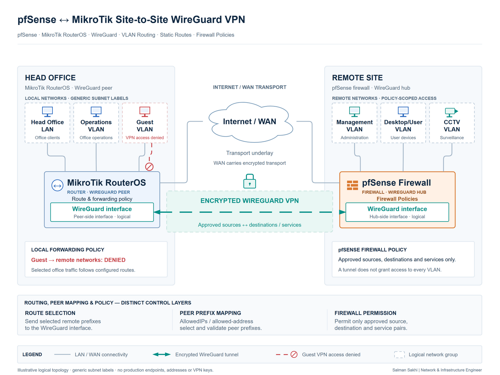

# pfSense ↔ MikroTik Site-to-Site WireGuard VPN

[**View Full Project on My Portfolio**](https://salman-sakhi.web.app/projects/pfsense-mikrotik-wireguard-vpn)

- **Engineering domain:** VPN & Network Security
- **Classification:** Production Experience
- **Lifecycle / verification scope:** Production Experience

## Technical objective

Connect separated office networks through encrypted WireGuard transport while retaining control over which networks and services can communicate. The objective is authorized inter-site access, including user and management segments, with routing and firewall policy defining the permitted scope.

## Infrastructure environment

The documented production integration uses pfSense as a WireGuard hub and MikroTik RouterOS as a remote peer. Networks and VLANs sit behind the respective platforms. The functional illustration labels the MikroTik side as Head Office and the pfSense side as Remote Site; these location labels do not change the documented peer roles.

## Technologies and equipment

- pfSense
- MikroTik RouterOS
- WireGuard
- VLANs
- Static Routing
- Firewall Policies

## My documented responsibilities

My documented scope covers the WireGuard peer relationship, encrypted inter-site transport, remote-network routing and explicit forwarding restrictions. It includes investigation through handshake state, traffic counters and reachability checks. Access requirements for management, users and guests need to be considered separately when configuring or extending the connection.

## Network or system architecture

*Sanitized logical architecture: Head Office LAN → MikroTik Router → WireGuard VPN → pfSense Firewall → Remote Site VLANs. Peer identities, endpoints, keys and production network details are private.*

The transport, route selection and forwarding policy are separate controls. WireGuard AllowedIPs associates prefixes with an authenticated peer; MikroTik names this setting allowed-address. It selects the peer for an outgoing inner destination and checks an accepted inner source on received decrypted traffic. It does not replace the operating system routing table or service-level firewall policy.

## Implementation or troubleshooting approach

Review peer identity, endpoint reachability, tunnel addressing and remote prefixes together. Check whether the route table sends the destination toward the WireGuard interface, then whether the intended peer accepts that prefix. RouterOS needs appropriate routes toward remote LANs; allowed-address alone does not install them.

Next, examine forwarding policy and valid return paths in both directions. Review any translation that changes the source seen by the remote side. Narrow permissions to required sources, destinations and services, and evaluate guest access independently from authorized office and management traffic.

## Operational challenges

A recent handshake can coexist with a failed application path. Routing, peer prefix mapping, the return route or a forwarding rule may differ from the intended design. Overlapping networks and broad rules also complicate extensions. Adding another VLAN therefore requires an access review rather than an assumption that tunnel membership grants access.

## Verification evidence

The current portfolio identifies production integration and describes handshake inspection, network reachability and counter analysis. Its topology is illustrative, and no operational captures, peer configuration or dated acceptance results accompany the record. Permitted-flow and denied-flow checks are validation criteria, not published passes. A handshake demonstrates peer communication; it does not independently prove application access or VLAN isolation.

## Outcome and current scope

The documented integration provides encrypted transport between pfSense and MikroTik environments with access governed through routing and firewall policy. The public scope supports discussion of cross-platform VPN administration without publishing secrets or claiming measured throughput, availability or a specific incident result.

## Related technical skills

WireGuard peer administration, static routing, VLAN-aware access control, firewall-counter analysis, return-path investigation and cross-platform troubleshooting.

## References

- [Current portfolio case study](https://salman-sakhi.web.app/projects/pfsense-mikrotik-wireguard-vpn) — canonical production scope and architectural explanation.
- [Earlier technical notes](../pfsense-mikrotik-wireguard.md) — supplemental outline, illustrative labels and proposed test criteria.
- [GitHub profile](../../README.md)
