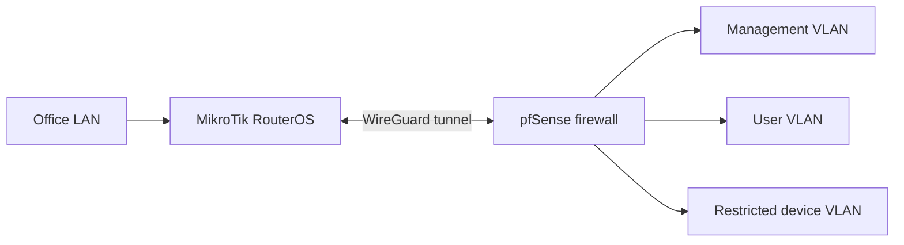

# pfSense ↔ MikroTik Site-to-Site WireGuard VPN

[**View full project on my portfolio →**](https://salman-sakhi.web.app/projects/pfsense-mikrotik-wireguard-vpn)

**Status:** Production experience  
**Technologies:** pfSense, MikroTik RouterOS, WireGuard, IPv4 routing, firewall rules, VLAN segmentation  
**Focus:** Encrypted connectivity between separated enterprise sites

## Objective

Interconnect networks behind pfSense and MikroTik while limiting access to approved internal subnets. Provide predictable routes and apply filtering at appropriate trust boundaries.

## Architecture (sanitized, illustrative)

*Logical illustration with invented labels, not a production topology export.*

## Engineering activities

- Configure a WireGuard peer relationship between MikroTik and pfSense.
- Include approved remote subnets in the relevant allowed-address / AllowedIPs policy.
- Configure routes for remote site networks without unintentionally redirecting Internet traffic.
- Create narrowly scoped firewall policies for management and application access.
- Verify tunnel handshakes, traffic counters and reachability from permitted networks.
- Review segmentation requirements so guest traffic cannot automatically reach restricted networks.

## What to test

| Test | Expected result |
|---|---|
| Peer handshake | Recent handshake and increasing relevant counters |
| Authorized LAN to remote management | Allowed through required route and firewall policy |
| Guest to restricted device VLAN | Blocked by policy |
| General Internet access | Preserved after VPN changes |
| Return traffic | Uses a valid route back to the originating subnet |

These are **test criteria**, not published results from a specific maintenance window.

## Security notes

Do not publish real tunnel keys, preshared secrets, public WAN addresses, private corporate subnets, or firewall exports. Diagram labels and any future demonstration configurations should use documentation ranges and a synthetic lab where possible.

## Evidence to add

- Sanitized tunnel overview.
- Route and firewall policy examples using test-only addresses.
- Redacted validation screenshots or lab packet captures.

[Back to profile](../README.md)
