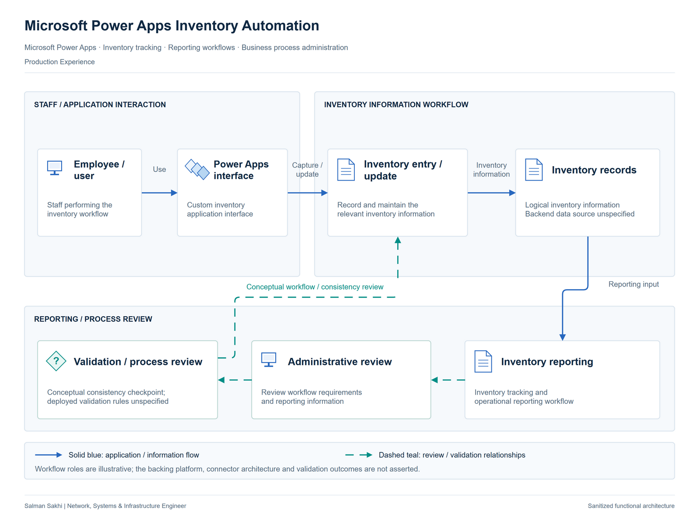

# Microsoft Power Apps Inventory Automation

[**View Full Project on My Portfolio**](https://salman-sakhi.web.app/projects/power-apps-inventory-automation)

- **Engineering domain:** Business Process Automation
- **Classification:** Production Experience
- **Lifecycle / verification scope:** Production Experience

## Technical objective

Develop a custom Microsoft Power Apps solution to support inventory tracking and operational reporting. The intended process connects the information staff record with the reports used for operational decisions and aims to reduce repetitive manual handling. The documented objective does not establish a measured time saving or an integrated ERP workflow.

## Infrastructure environment

The functional environment consists of staff using Power Apps for inventory information and reporting. The backing data source, connectors, application screens, version and integration architecture are unspecified. The record does not identify SharePoint, Dataverse, SQL or another backend, so no platform-specific data design is inferred. Production business records remain outside this public case.

## Technologies and equipment

- Microsoft Power Apps
- Inventory Tracking
- Reporting Workflows
- Business Process Automation

## My documented responsibilities

I developed custom Microsoft Power Apps solutions for inventory tracking and reporting workflows. My documented work includes custom application development, inventory workflow support and reporting workflow development for operational use. This application and process-automation scope complemented my infrastructure responsibilities; the available record does not describe individual screens, formulas or connector configuration.

## Network or system architecture

*Illustrative architecture. The backing data source, connectors and validation implementation are unspecified. Review checkpoints describe the functional workflow, not completed tests.*

The functional workflow connects staff inventory updates, record handling, review checkpoints and operational reporting. It explains the relationship between people, maintained information and reporting decisions. Review checkpoints represent places where the process should be examined. They are not evidence of implemented validation logic, completed acceptance testing or an approved dataset.

## Implementation or troubleshooting approach

Start by identifying what staff need to record and what decisions the reporting should support. Review the process and appropriate participant access with its owner before adding automation. Agree what each record represents and how changes should affect the reported information. Those requirements should guide the eventual data and connector choices. The case does not supply implementation details or test results sufficient to reconstruct a deployed application's behavior.

## Operational challenges

Inventory tracking depends on a shared understanding of record meaning and update ownership. An application can present information consistently while the underlying process still leaves ambiguity about when an update is complete or which report should change. Data consistency, access and reporting expectations therefore need review together. Backend and integration decisions should follow those requirements rather than be assumed from the use of Power Apps.

## Verification evidence

The professional record reports custom Power Apps development for inventory tracking and reporting. No backend specification, connector inventory, validation record, application version or completed integration test is supplied. The workflow diagram's review stages do not claim those tests passed. There is no measured processing-time reduction, confirmed automated ERP integration or public production dataset in this case.

## Outcome and current scope

The current scope is documented development of Power Apps inventory and reporting solutions. The deliverable supports discussion of the operational workflow while leaving implementation architecture and validation outcomes subject to further evidence. Efficiency improvement remains an intended benefit rather than a quantified achievement.

## Related technical skills

Related skills include custom Power Apps development, inventory workflow analysis, operational reporting and business process automation. The practical emphasis is translating the work staff perform into a structured application workflow without assigning unrecorded technologies or validation results.

## References

- [Full portfolio case study](https://salman-sakhi.web.app/projects/power-apps-inventory-automation) — current project narrative and scope.
- [Professional profile](../../README.md) — related experience and technical skills.
