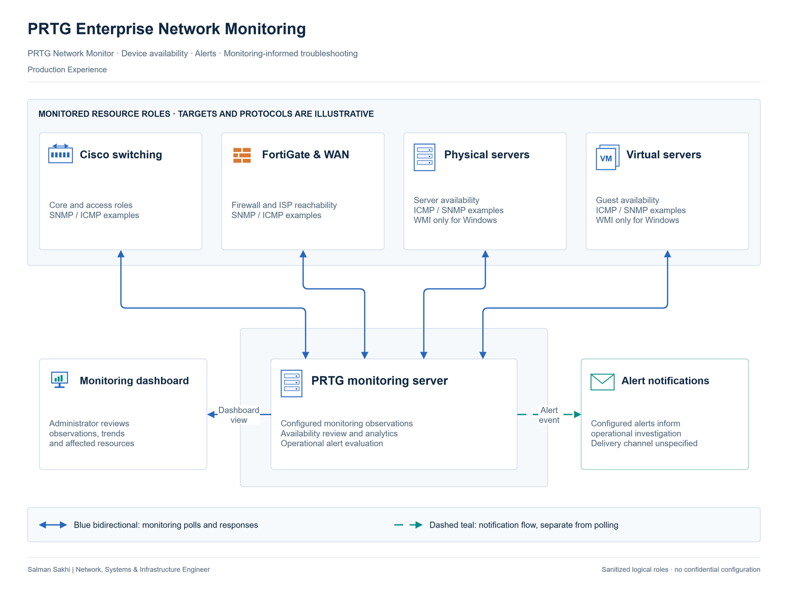

# PRTG Enterprise Network Monitoring

[**View Full Project on My Portfolio**](https://salman-sakhi.web.app/projects/prtg-enterprise-network-monitoring)

- **Engineering domain:** Monitoring & Observability
- **Classification:** Production Experience
- **Lifecycle / verification scope:** Production Experience

## Technical objective

Use PRTG monitoring information to identify availability changes and give network support a useful starting point for investigation. Alerts and analytics help establish the affected scope and prioritize checks. The objective concerns operational visibility; a monitoring alert still requires investigation before it can be assigned a root cause.

## Infrastructure environment

This work took place in an enterprise network support role. PRTG monitored network resources and presented availability information for administrative review. The public record does not identify the monitored devices, server roles, sensor inventory, collector placement or enabled protocols. Any target categories and polling methods in the illustration are explanatory examples.

## Technologies and equipment

- PRTG Network Monitor
- Network Device Monitoring
- Availability Monitoring
- Alerts
- Network Traffic Analysis

## My documented responsibilities

I implemented PRTG Network Monitor and monitored enterprise network devices, using alerts and analytics to support incident investigation. My scope included availability review, alert review and the use of monitoring information to guide troubleshooting priorities. These responsibilities formed part of my wider network support work.

## Network or system architecture

*Illustrative architecture. Target categories and polling methods illustrate monitoring roles; the production inventory and enabled checks are not specified.*

The functional architecture connects monitored resource roles to PRTG collection, dashboards and notifications, followed by administrator investigation. The architecture explains how an observation becomes actionable context. It does not establish that a particular device category, polling protocol, dashboard layout or notification channel was enabled in the production installation.

## Implementation or troubleshooting approach

For an alert, first identify the affected resource, its timing and the extent of the reported condition. Compare that observation with neighboring resources, link state and the connectivity symptom reported by users. Then choose the next relevant network check. Sensor relevance, notification recipients and reporting needs should be agreed with the operator. Thresholds should reflect the actual monitored condition; their deployed values are unconfirmed here.

## Operational challenges

The path used to monitor a device can fail even when the device itself remains operational. A single availability change therefore needs context from related links and services. Multiple alerts may describe one underlying interruption. Conversely, a normal device observation may not cover the application a user cannot reach. Useful monitoring connects observations to the service being investigated.

## Verification evidence

The professional record supports PRTG implementation and operation. This case supplies no dashboard export, sensor configuration, alert-threshold record or independently established device count. Polling protocols and target examples remain illustrative. There is no measured reduction in incident duration, validated alert-delivery result or documented MTTR improvement to publish. Monitoring observations would need their own retained evidence for those claims.

## Outcome and current scope

The documented outcome is implementation and ongoing use of PRTG for network monitoring, with alerts and analytics supporting investigation. It provides an operational monitoring scope while leaving installation-specific configuration and quantified benefits subject to confirmation. The diagram communicates roles rather than a verified production inventory.

## Related technical skills

Related skills include network-device monitoring, availability assessment, alert interpretation, network traffic analysis and monitoring-informed troubleshooting. The practical connection is between an observed change, its likely affected scope and the next check needed to understand the service condition.

## References

- [Full portfolio case study](https://salman-sakhi.web.app/projects/prtg-enterprise-network-monitoring) — current project narrative and scope.
- [Professional profile](../../README.md) — related experience and technical skills.
