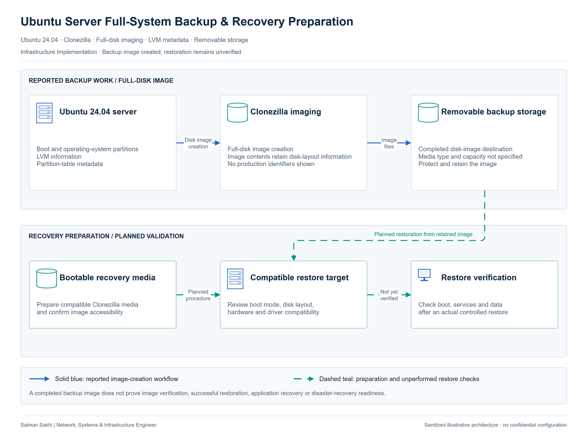

# Ubuntu Server Full-System Backup & Recovery Preparation

[**View Full Project on My Portfolio**](https://salman-sakhi.web.app/projects/ubuntu-server-backup-recovery)

- **Engineering domain:** Server Backup & Recovery
- **Classification:** Infrastructure Implementation
- **Lifecycle / verification scope:** Backup & Recovery Preparation

## Technical objective

Preserve an Ubuntu 24.04 server as a full-system disk image so that recovery preparation includes the operating system and the disk structure it depends on. The objective extends beyond copying selected files: boot information, partitions, LVM information and partition-table metadata belong to the recovery artifact.

## Infrastructure environment

The documented source is an Ubuntu 24.04 server, with Clonezilla used to save its disk image to removable storage. Hardware, workload, firmware boot mode and production-versus-lab context are unspecified. Image size, destination capacity, compression settings and elapsed backup time are also outside the supplied record.

## Technologies and equipment

- Ubuntu 24.04
- Clonezilla
- Linux
- LVM
- Disk Imaging
- Removable Storage

## My documented responsibilities

My documented work was creating the server disk image with Clonezilla. The saved artifact covers boot and operating-system partitions together with LVM and partition-table information. Recovery-media preparation, integrity checking and a controlled restoration are separate stages requiring their own evidence; I do not present those stages as completed responsibilities here.

## Network or system architecture

*Illustrative architecture. Disk image created; bare-metal restoration is not verified.*

The workflow connects the source server to Clonezilla imaging and the removable image repository, then shows the later recovery and validation stages. The repository needs to retain the image files and their associated metadata together. Planned restore stages explain the recovery path without implying that the replacement system has already booted successfully.

## Implementation or troubleshooting approach

The completed action is full-disk imaging. A subsequent recovery procedure should first establish access to the saved image and suitable Clonezilla Live media. Before restoration, confirm the destination disk, capacity, controller compatibility, boot mode and LVM requirements. Use an approved maintenance plan and controlled target, then assess operating-system boot and required services separately. These are proposed recovery checks.

## Operational challenges

A saved image is useful only if its files remain accessible and the recovery environment can use the intended hardware. Target-disk selection also matters because restoration overwrites data. Retention, independent copies, access protection and recovery of changes made after imaging remain planning decisions. Removable storage alone does not establish a complete recovery strategy.

## Verification evidence

The supplied record confirms creation of the disk image to removable storage. It supplies no completed image-integrity report, successful recovery-media compatibility test or bare-metal restore result. An integrity check would address image consistency; a controlled restore with boot and service checks would address recoverability. Neither result can be inferred from image creation.

## Outcome and current scope

The current outcome is a completed Ubuntu server image and a defined boundary around recovery preparation. The next useful evidence is an image-check result and a documented controlled restoration. Production context remains unspecified, and no recovery-time or recovery-point guarantee is claimed.

## Related technical skills

Related skills include Linux disk-layout interpretation, LVM awareness, Clonezilla imaging and recovery-procedure planning. This case supports discussion of backup artifacts and verification stages while keeping practical restoration experience subject to confirmation.

## References

- [Full portfolio case study](https://salman-sakhi.web.app/projects/ubuntu-server-backup-recovery) — current project narrative and scope.
- [Professional profile](../../README.md) — related experience and technical skills.
