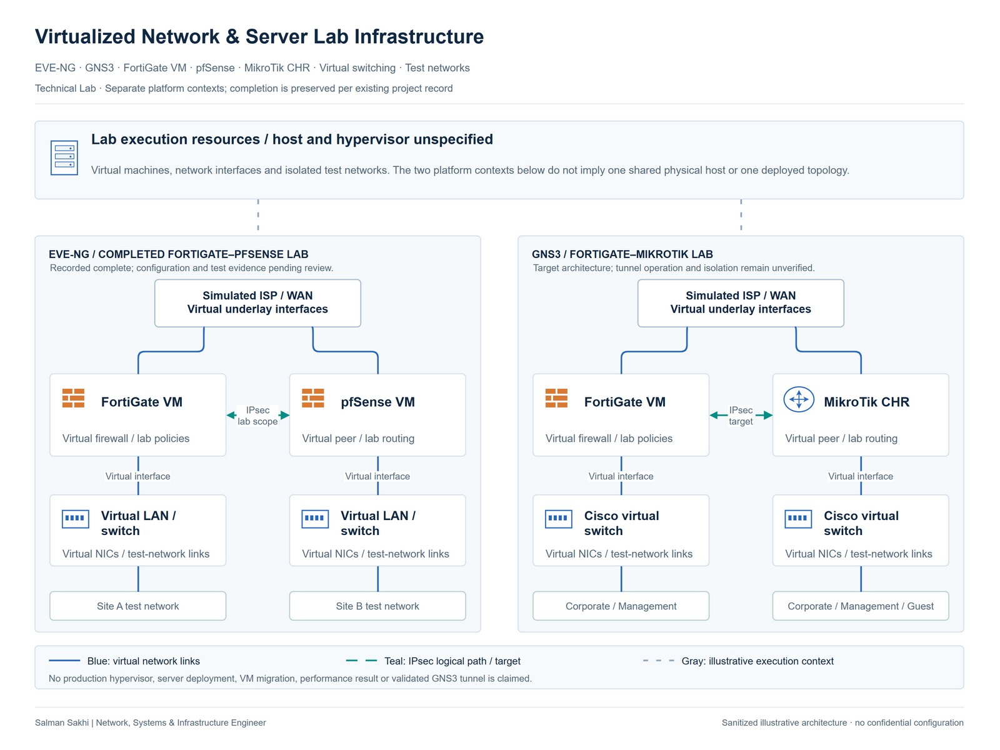

# Virtualized Network & Server Lab Infrastructure

[**View Full Project on My Portfolio**](https://salman-sakhi.web.app/projects/virtualized-network-server-lab)

- **Engineering domain:** Virtual Infrastructure Lab
- **Classification:** Technical Lab
- **Lifecycle / verification scope:** Technical Lab

## Technical objective

Use virtual network infrastructure to investigate routing, security boundaries and cross-vendor VPN behavior in controlled experiments. The lab infrastructure provides devices, virtual interfaces and test segments for specific scenarios. Results must stay attached to the individual experiment rather than become a general claim that every platform and tunnel works.

## Infrastructure environment

The documented environments are EVE-NG for the FortiGate/pfSense IPsec lab and GNS3 for the FortiGate/MikroTik CHR VLAN and IPsec lab. Their host hardware, hypervisor and physical placement are unspecified, including whether they share a host. Linux test endpoints appear in the lab skill inventory. These environments are technical labs.

## Technologies and equipment

- GNS3
- EVE-NG
- FortiGate VM
- MikroTik CHR
- pfSense
- Cisco Virtual Switches
- Linux

## My documented responsibilities

My documented lab scope includes virtual-device configuration and investigation of the links, routing, switching and policy relationships behind the VPN scenarios. The inventory includes virtual firewalls, MikroTik CHR and Cisco virtual switches. I keep the EVE-NG and GNS3 cases separate because their verification states differ and their underlying physical deployment is not established.

## Network or system architecture

*Illustrative architecture. Conceptual lab infrastructure; GNS3 end-to-end IPsec operation remains unverified.*

The conceptual architecture places virtual appliances and test endpoints on simulated WAN, LAN and VLAN segments. Virtual interface and switch mapping determines which path a packet can take before routing or VPN policy is evaluated. The illustration provides relationships only; it does not specify host bridges, interface names or a production hypervisor configuration.

## Implementation or troubleshooting approach

Begin with the intended scenario and map every virtual interface to its switch and network. Continue through addressing, VLAN membership, gateway placement, routes, firewall policy and NAT. Assess VPN negotiation separately from protected-network and application reachability. Packet captures and device counters can compare the intended path with observed behavior. Record configuration changes and experiment state so an unresolved fault remains reproducible.

## Operational challenges

A virtual link can appear connected while an interface belongs to the wrong test segment. Simulated WAN transport, protected networks and any physical-network attachment need clear boundaries. Cross-vendor negotiation adds another diagnostic layer, but a negotiated tunnel still requires usable routes and permitted traffic. Lab snapshots, migrations and recovery procedures are not documented achievements in this overview.

## Verification evidence

The EVE-NG FortiGate/pfSense project is recorded as a completed lab, with evidence pending review. The GNS3 FortiGate/MikroTik project remains unverified and has not established verified end-to-end IPsec operation. This infrastructure overview adds no new packet captures, command results or successful tests. Platform inventory alone cannot resolve either project's evidence status.

## Outcome and current scope

The documented outcome is lab infrastructure supporting separate vendor-interoperability investigations. The EVE-NG completion record and the unresolved GNS3 validation boundary remain visible. This work does not establish a production ESXi or Hyper-V deployment, shared-host architecture or completed VM migration.

## Related technical skills

Related skills include virtual network mapping, GNS3 and EVE-NG scenario organization, VLAN and routing analysis, firewall-policy review and VPN troubleshooting. Each skill should be discussed in the context of its recorded experiment and available evidence.

## References

- [Full portfolio case study](https://salman-sakhi.web.app/projects/virtualized-network-server-lab) — current project narrative and scope.
- [Professional profile](../../README.md) — related experience and technical skills.
