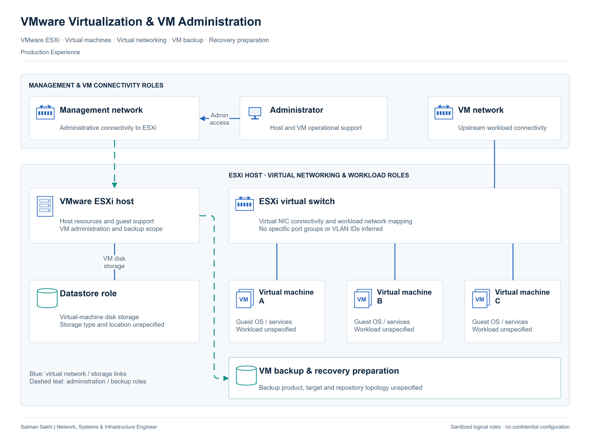

# VMware Virtualization & VM Administration

[**View Full Project on My Portfolio**](https://salman-sakhi.web.app/projects/vmware-virtualization-administration)

- **Engineering domain:** Virtualization & Server Operations
- **Classification:** Production Experience
- **Lifecycle / verification scope:** Production Experience

## Technical objective

Support virtualized workloads by considering the VMware host, the virtual machine and the services running inside the guest together. The operational objective includes VM administration and VMware-based backup responsibilities within an existing enterprise infrastructure. A useful investigation follows the affected service through its virtualization and network dependencies.

## Infrastructure environment

VMware ESXi provides the virtualization role described in my professional record. Virtual machines depend on host resources, virtual networking and guest operating-system services. Host specifications, guest inventory, datastore type and the physical storage backend are unspecified. The backup product, repository design and recovery targets are also outside the available architecture record.

## Technologies and equipment

- VMware ESXi
- Virtual Machine Management
- Virtual Networking
- VM Backup
- Recovery Planning

## My documented responsibilities

I worked with VMware ESXi, virtual-machine administration and VMware-based backup arrangements as part of broader enterprise server and infrastructure administration. My documented responsibilities include VM operational support, ESXi backup work, backup documentation and recovery preparation. The record supports that practical scope without establishing a separate centralized-management or cluster deployment.

## Network or system architecture

*Illustrative architecture. Datastore type and backup product or repository are unspecified. The illustration does not depict clustering, vCenter or vMotion.*

The logical diagram relates ESXi, virtual machines, virtual switching, management access, datastore and backup roles. The datastore is a functional requirement for VM storage, not a claim about a selected storage technology. Backup represents the recorded operational responsibility. The illustration does not depict vCenter, clustering or a vMotion path.

## Implementation or troubleshooting approach

Begin by identifying whether the symptom concerns host resources, guest behavior, virtual connectivity or an application dependency. Review virtual interface mapping, guest addressing and the upstream route in the context of the affected service. For backup work, separately establish workload coverage, the recoverable artifact and the intended recovery procedure. Confirm which post-restore checks would demonstrate usable service before treating recovery as complete.

## Operational challenges

A VM can be powered on while its application is unavailable. Virtual networking and guest service behavior can create similar user symptoms but require different investigation. Likewise, the existence of a backup does not establish that the intended workload can be recovered. Ownership of recovery decisions and the required service checks needs to be clear before changes or restore activity.

## Verification evidence

The professional record reports VMware experience, VM management and ESXi-based backup responsibilities. It does not supply restore-test results, performance measurements or a verified recovery target. vCenter and vMotion appear in the skill inventory without a specific administration or successful migration record; they remain familiarity only. No vCenter, vMotion or high-availability deployment is claimed in this case.

## Outcome and current scope

The current case documents production VM administration and VMware backup responsibilities. It complements the separate GNS3 and EVE-NG lab case while retaining its own evidence boundary. There is no claimed successful migration, HA test or bare-metal recovery, and no inferred storage-backend implementation.

## Related technical skills

Related skills include VMware ESXi operations, virtual-machine management, virtual network troubleshooting, VM backup review and recovery planning. vCenter and vMotion familiarity should be described separately from the operational work documented here.

## References

- [Full portfolio case study](https://salman-sakhi.web.app/projects/vmware-virtualization-administration) — current project narrative and scope.
- [Professional profile](../../README.md) — related experience and technical skills.
